# Inventario del backend Access (`Database_be.accdb`)

- Generado: **2026-10-27 17:32** (solo lectura, sobre el NAS)
- Origen: `\\nas.cifs.cti-sevilla.sas.junta-andalucia.es\SSCC-CONSTITUCION-1\SSCC\Sb-ServiciosGestionCentros\FondosEuropeos\Database_be.accdb`
- Generado por: `herramientas/inventario.py`
- Tablas: **49** · Relaciones declaradas en `RelacionesAccessT`: **57**
- Observación: las relaciones están **sin integridad referencial**, así que Access no impide huérfanos.

## 1. Resumen de tablas

| Tabla | Categoría | Filas | Columnas |
|---|---|---|---|
| EstadosExpedienteT | catálogo | 43 | 2 |
| EstadosActuacionT | catálogo | 20 | 4 |
| TextosT | catálogo | 15 | 3 |
| ProvT | catálogo | 8 | 3 |
| EstadoT | catálogo | 7 | 2 |
| EstadosCreditoT | catálogo | 5 | 3 |
| TiposObjetosContratosT | catálogo | 5 | 4 |
| EstadosContratosT | catálogo | 4 | 3 |
| TiposDocumentosContablesT | catálogo | 3 | 3 |
| EdificiosT | datos | 1957 | 4 |
| CampusT | datos | 1838 | 13 |
| CreditosT | datos | 1751 | 10 |
| UsuariosT | datos | 1260 | 30 |
| CEET | datos | 1004 | 24 |
| ContratosT | datos | 717 | 7 |
| BitacoraT | datos | 712 | 22 |
| LotesT | datos | 485 | 21 |
| ActuacionesT | datos | 358 | 38 |
| MAEsT | datos | 126 | 10 |
| GIRO_FE04_Edgar | datos | 102 | 61 |
| OperacionesT | datos | 95 | 14 |
| OrganosGestoresT | datos | 57 | 2 |
| ExpedientesT | datos | 46 | 81 |
| CriteriosRevisionT | datos | 33 | 3 |
| FechaFin | datos | 26 | 5 |
| AuditoriasT | datos | 14 | 8 |
| Expedientes_v0T | datos | 9 | 9 |
| IPAExpedientesT | datos | 6 | 53 |
| ProyectosT | datos | 1 | 20 |
| DocumContableT | datos | 0 | 7 |
| EtiquetasT | datos | 0 | 1 |
| FasesExpedienteT | datos | 0 | 4 |
| SolicitudesT | datos | 0 | 11 |
| AmbitoIntervencionT | marco FEDER | 182 | 5 |
| IndicadoresRealizacion | marco FEDER | 7 | 8 |
| IndicadoresResultado | marco FEDER | 3 | 8 |
| MedidasT | marco FEDER | 3 | 6 |
| ObjetivosEspecificosT | marco FEDER | 2 | 5 |
| RelLoteActuacionT | relación N:M | 408 | 3 |
| RelActuacEdifCertT | relación N:M | 336 | 6 |
| RelacionesAccessT | relación N:M | 59 | 11 |
| RelMedidaIndicadorT | relación N:M | 9 | 4 |
| RelFechaActuacionT | relación N:M | 0 | 3 |
| 20250725RevCEEInicActuac | revisión puntual | 358 | 4 |
| 20250630_RevDocumT | revisión puntual | 38 | 11 |
| 20250904_ClimateProofingMedida044 | revisión puntual | 16 | 5 |
| 20250730_RevFVPliegosAxarquia | revisión puntual | 11 | 4 |
| 20250714_CriterioAdjuReducPlazo | revisión puntual | 9 | 4 |
| 20250801RevisiónDescripExcelCompartido | revisión puntual | 0 | 3 |

## 2. Diagrama de relaciones

```mermaid
erDiagram
    ExpedientesT ||--o{ FasesExpedienteT : "Expediente"
    ExpedientesT ||--o{ LotesT : "Expediente"
    ActuacionesT ||--o{ RelLoteActuacionT : "Actuacion"
    ActuacionesT ||--o{ RelFechaActuacionT : "Actuacion"
    BitacoraT ||--o{ t20250730_RevFVPliegosAxarquia : "Comentario"
    OperacionesT ||--o{ ActuacionesT : "Operacion"
    ProvT ||--o{ t20250714_CriterioAdjuReducPlazo : "Prov"
    ProvT ||--o{ BitacoraT : "Prov"
    EdificiosT ||--o{ CEET : "Edificio"
    OperacionesT ||--o{ t20250630_RevDocumT : "FE04"
    EstadosExpedienteT ||--o{ FasesExpedienteT : "Fase"
    LotesT ||--o{ RelLoteActuacionT : "Lote"
    CreditosT ||--o{ BitacoraT : "Creditos"
    ExpedientesT ||--o{ CreditosT : "Expediente"
    LotesT ||--o{ BitacoraT : "LotesT"
    EstadosActuacionT ||--o{ ActuacionesT : "EstadoActuacion"
    MedidasT ||--o{ BitacoraT : "Medida"
    AuditoriasT ||--o{ MAEsT : "Auditoria"
    BitacoraT ||--o{ t20250630_RevDocumT : "Comentario"
    ActuacionesT ||--o{ AuditoriasT : "Actuacion"
    IndicadoresRealizacion ||--o{ RelMedidaIndicadorT : "IndRealiz"
    OperacionesT ||--o{ ActuacionesT : "Oper"
    ActuacionesT ||--o{ t20250730_RevFVPliegosAxarquia : "Actuacion"
    EstadoT ||--o{ Expedientes_v0T : "Estado"
    EstadosCreditoT ||--o{ CreditosT : "EstadoContable"
    MedidasT ||--o{ SolicitudesT : "MedidaSolicitada"
    IndicadoresResultado ||--o{ RelMedidaIndicadorT : "IndRes"
    ExpedientesT ||--o{ BitacoraT : "Expediente"
    OperacionesT ||--o{ BitacoraT : "Operacion_Value"
    EstadoT ||--o{ ExpedientesT : "Estado"
    EdificiosT ||--o{ CampusT : "Código"
    OperacionesT ||--o{ BitacoraT : "FE04"
    ActuacionesT ||--o{ CreditosT : "Actuacion"
    ActuacionesT ||--o{ t20250801RevisiónDescripExcelCompartido : "Actuac"
    MedidasT ||--o{ OperacionesT : "Medida"
    ActuacionesT ||--o{ MAEsT : "Actuacion"
    ActuacionesT ||--o{ BitacoraT : "Actuacion"
    EdificiosT ||--o{ BitacoraT : "IDEdificio_Value"
    OperacionesT ||--o{ BitacoraT : "Oper"
    ActuacionesT ||--o{ t20250904_ClimateProofingMedida044 : "Actuacion"
    UsuariosT ||--o{ ActuacionesT : "Resp"
    MedidasT ||--o{ RelMedidaIndicadorT : "Medida"
    Expedientes_v0T ||--o{ IPAExpedientesT : "IdExpediente"
    ActuacionesT ||--o{ t20250725RevCEEInicActuac : "Actuacion"
    MedidasT ||--o{ ActuacionesT : "Medida"
    ProvT ||--o{ ExpedientesT : "PRV"
    EstadosExpedienteT ||--o{ BitacoraT : "ExpedienteEstado"
    ActuacionesT ||--o{ ContratosT : "Actuacion"
    ActuacionesT ||--o{ ProyectosT : "Actuacion"
    CEET ||--o{ BitacoraT : "CEE"
    EdificiosT ||--o{ RelActuacEdifCertT : "Edificio"
    EstadosContratosT ||--o{ ContratosT : "Estado"
    LotesT ||--o{ ContratosT : "Lote"
    ObjetivosEspecificosT ||--o{ ActuacionesT : "Ambito"
    TiposDocumentosContablesT ||--o{ DocumContableT : "Tipo"
    TiposObjetosContratosT ||--o{ ContratosT : "Objeto"
    TiposObjetosContratosT ||--o{ CreditosT : "ObjetoExpdte"
```

## 3. Detalle por tabla

### 20250630_RevDocumT

- Categoría: revisión puntual · Filas: **38** · Columnas: **11** · Clave primaria: id
- Referencia a: `FE04` → OperacionesT.IDop; `Comentario` → BitacoraT.IdBitacora

| Columna | Tipo | % nulos | Distintos | Rango | Valores frecuentes | Descripción (Access) |
|---|---|---|---|---|---|---|
| id | Entero largo | 0% | 38 | 1 → 42 | 1 (1); 2 (1); 3 (1); 4 (1); 5 (1); 6 (1) | id |
| FE04 | Entero largo | 0% | 38 | 41 → 92 | 41 (1); 42 (1); 44 (1); 45 (1); 46 (1); 47 (1) | FE04 incluido en el listado |
| MEM | Sí/No | 0% | 1 |  | True (38) | comprueba si está |
| PPT | Sí/No | 0% | 2 |  | True (34); False (4) |  |
| PCAP | Sí/No | 0% | 2 |  | True (34); False (4) |  |
| CR | Sí/No | 0% | 2 |  | True (30); False (8) |  |
| Aud | Sí/No | 0% | 2 |  | False (26); True (12) |  |
| JustifEcon | Sí/No | 0% | 2 |  | True (35); False (3) |  |
| Observaciones | Texto | 79% | 8 |  | CM de Granada (1); Valme no hay expediente (1); La merced FV no hay expediente (1); No hay expediente VR. Modif FE04 (1); Muñoz Cari no hay exp (1); Memoria Alta operación lavandería (1) |  |
| Actualización | Fecha/Hora | 87% | 1 | 2025-08-01 00:00:00 → 2025-08-01 00:00:00 | 2025-08-01 00:00:00 (5) |  |
| Comentario | Entero largo | 100% | 0 |  |  |  |

### 20250714_CriterioAdjuReducPlazo

- Categoría: revisión puntual · Filas: **9** · Columnas: **4** · Clave primaria: Id
- Referencia a: `Prov` → ProvT.Id

| Columna | Tipo | % nulos | Distintos | Rango | Valores frecuentes | Descripción (Access) |
|---|---|---|---|---|---|---|
| Id | Entero largo | 0% | 9 | 1 → 9 | 1 (1); 2 (1); 3 (1); 4 (1); 5 (1); 6 (1) |  |
| Avisado | Sí/No | 0% | 2 |  | True (8); False (1) |  |
| Prov | Entero largo | 11% | 8 | 4.0 → 41.0 | 4.0 (1); 11.0 (1); 14.0 (1); 18.0 (1); 21.0 (1); 23.0 (1) |  |
| Observaciones | Texto | 11% | 4 |  | mail 20251407 (5); Ya lo sabe. Domingo es el que llama a AOC porque es el que h… (1); AOC habla con Demetrio por tlf para informar (1); Hablo con Ana Daban por tlf para indicar (1) |  |

### 20250725RevCEEInicActuac

- Categoría: revisión puntual · Filas: **358** · Columnas: **4** · Clave primaria: Id
- Referencia a: `Actuacion` → ActuacionesT.IDActuacion

| Columna | Tipo | % nulos | Distintos | Rango | Valores frecuentes | Descripción (Access) |
|---|---|---|---|---|---|---|
| Id | Entero largo | 0% | 358 | 1 → 358 | 1 (1); 2 (1); 3 (1); 4 (1); 5 (1); 6 (1) |  |
| Actuacion | Entero largo | 0% | 358 | 1 → 365 | 2 (1); 110 (1); 111 (1); 113 (1); 114 (1); 115 (1) |  |
| CEE | Texto | 98% | 6 |  | PRY/000305615/01/2016 (1); PRY/000306466/01/2016 (1); PRY/000306453/01/2016 (1); PRY/000306241/01/2016 (1); PRY/000306282/01/2016 (1); PRY/000305562/01/2016 (1) | PRY |
| UltimaRevision | Fecha/Hora | 98% | 2 | 2025-07-28 00:00:00 → 2025-07-29 00:00:00 | 2025-07-28 00:00:00 (3); 2025-07-29 00:00:00 (3) |  |

### 20250730_RevFVPliegosAxarquia

- Categoría: revisión puntual · Filas: **11** · Columnas: **4** · Clave primaria: Id
- Referencia a: `Comentario` → BitacoraT.IdBitacora; `Actuacion` → ActuacionesT.IDActuacion

| Columna | Tipo | % nulos | Distintos | Rango | Valores frecuentes | Descripción (Access) |
|---|---|---|---|---|---|---|
| Id | Entero largo | 0% | 11 | 1 → 12 | 1 (1); 2 (1); 3 (1); 4 (1); 5 (1); 6 (1) |  |
| Actuacion | Entero largo | 0% | 11 | 110 → 349 | 115 (1); 349 (1); 345 (1); 111 (1); 116 (1); 348 (1) |  |
| PliegoNoIncluyeFV | Sí/No | 0% | 1 |  | True (11) |  |
| Comentario | Entero largo | 82% | 2 | 353.0 → 357.0 | 353.0 (1); 357.0 (1) |  |

### 20250801RevisiónDescripExcelCompartido

- Categoría: revisión puntual · Filas: **0** · Columnas: **3** · Clave primaria: Id
- Referencia a: `Actuac` → ActuacionesT.IDActuacion

| Columna | Tipo | % nulos | Distintos | Rango | Valores frecuentes | Descripción (Access) |
|---|---|---|---|---|---|---|
| Id | Entero largo | — | 0 |  |  |  |
| Actuac | Entero largo | — | 0 |  |  |  |
| MedidasFinales | Texto | — | 0 |  |  |  |

### 20250904_ClimateProofingMedida044

- Categoría: revisión puntual · Filas: **16** · Columnas: **5** · Clave primaria: Id
- Referencia a: `Actuacion` → ActuacionesT.IDActuacion

| Columna | Tipo | % nulos | Distintos | Rango | Valores frecuentes | Descripción (Access) |
|---|---|---|---|---|---|---|
| Id | Entero largo | 0% | 16 | 1 → 16 | 1 (1); 2 (1); 3 (1); 4 (1); 5 (1); 6 (1) |  |
| Actuacion | Entero largo | 0% | 16 | 2 → 349 | 2 (1); 286 (1); 287 (1); 110 (1); 111 (1); 113 (1) |  |
| Fachada | Sí/No | 0% | 2 |  | True (13); False (3) |  |
| Cubierta | Sí/No | 0% | 2 |  | False (12); True (4) |  |
| MedidasRevisadas | Sí/No | 0% | 1 |  | True (16) |  |

### ActuacionesT

- Categoría: datos · Filas: **358** · Columnas: **38** · Clave primaria: —
- Referencia a: `Operacion` → OperacionesT.IDOperacion; `EstadoActuacion` → EstadosActuacionT.IdEstAct; `Oper` → OperacionesT.IDop; `Resp` → UsuariosT.Usuario; `Medida` → MedidasT.IDMedida; `Ambito` → ObjetivosEspecificosT.Id
- Referenciada por: RelLoteActuacionT.Actuacion; RelFechaActuacionT.Actuacion; AuditoriasT.Actuacion; 20250730_RevFVPliegosAxarquia.Actuacion; CreditosT.Actuacion; 20250801RevisiónDescripExcelCompartido.Actuac; MAEsT.Actuacion; BitacoraT.Actuacion; 20250904_ClimateProofingMedida044.Actuacion; 20250725RevCEEInicActuac.Actuacion; ContratosT.Actuacion; ProyectosT.Actuacion

| Columna | Tipo | % nulos | Distintos | Rango | Valores frecuentes | Descripción (Access) |
|---|---|---|---|---|---|---|
| CodActuacion | Texto | 0% | 358 |  | JA_21043_1 (1); JA_21179_1 (1); JA_21306_1 (1); JA_21715_1 (1); JA_22122_1 (1); GR_21660_1 (1) |  |
| PROV | Texto | 0% | 8 |  | JA (88); MA (68); CO (57); GR (48); CA (36); HU (25) |  |
| CodCentr | Texto | 0% | 316 |  | 10128 (5); 10019 (4); 10007H (3); 10048 (2); 10404 (2); 22919 (2) |  |
| N | Doble | 0% | 5 | 1.0 → 5.0 | 1.0 (314); 2.0 (37); 3.0 (3); 4.0 (3); 5.0 (1) |  |
| PROVINCIA | Texto | 0% | 9 |  | JAEN (88); MALAGA (68); CÓRDOBA (57); GRANADA (48); CÁDIZ (36); HUELVA (25) |  |
| ORGANO GESTOR | Texto | 0% | 49 |  | AGS NORTE DE JAÉN (36); DAP GUADALQUIVIR (23); DAP COSTA DEL SOL (21); DAP JAEN (20); AGS ESTE DE MALAGA - AXARQUÍA (17); DAP CORDOBA (16) |  |
| CENTRO SANITARIO | Texto | 0% | 339 |  | HOSPITAL DE JEREZ (2); C.S. AVDA. AEROPUERTO (2); C.S. GUADALQUIVIR (2); C.S. FUENTE PALMERA (2); C.S. POSADAS (2); C.S. VILLAVICIOSA (2) |  |
| 1_TIPO_INSTALACION | Texto | 0% | 2 |  | PANELES FOTOVOLTAICOS (319); EFICIENCIA ENERGÉTICA (39) |  |
| 2_DETALLE_INSTALACION | Texto | 10% | 315 |  | Esta actuación está prevista en el centro CENTRO DE SALUD DE… (12); Esta actuación está prevista en el centro Centro de Salud De… (10); Esta actuación está prevista en el centro Hospital Universit… (8); Esta actuación está prevista en el centro HOSPITAL SANTA ANA… (4); Esta actuación está prevista en el centro HOSPITAL UNIVERSIT… (4); Esta actuación está prevista en el centro Centro de salud Al… (4) |  |
| ACTUACIONES PREVISTAS | Memo/Texto largo | 0% | 345 |  | SUSTITUCION LUMINARIAS, SUSTITUCION VENTANAS, MEJORA AISLAMI… (12); Actuación ubicada en el municipio de JAEN , con la denominac… (10); Esta actuación está prevista en el centro Centro de Salud De… (10); Actuación ubicada en el municipio de JAÉN , con la denominac… (6); Esta actuación está prevista en el centro CENTRO DE SALUD DE… (4); Esta actuación está prevista en el centro HOSPITAL SANTA ANA… (4) |  |
| Inversión de ejecución material Estimada (€)  _PEM  | Moneda | 0% | 285 | 2025.0 → 15994173.0 | 15000.0 (12); 27500.0 (11); 20000.0 (9); 14500.0 (7); 19800.0 (5); 48351.0 (5) |  |
| ImportePro | Moneda | 0% | 283 | 0.0 → 1151500.49 | 1079.93 (12); 2216.06 (10); 1979.86 (8); 1439.9 (8); 1043.93 (7); 1108.03 (5) |  |
| IMPORTE TOTAL  | Moneda | 0% | 288 | 3353.1671 → 26484511.1581 | 24838.275 (12); 33117.7 (9); 45536.8375 (8); 24010.3325 (7); 33577.08 (5); 80063.6956 (5) |  |
| Operacion | Texto | 0% | 87 |  | 59 (33); 87 (31); 88 (28); 12 (26); 48 (23); 25 (19) |  |
| Oper | Entero largo | 0% | 92 | 1 → 100 | 59 (33); 87 (31); 88 (28); 12 (26); 48 (22); 25 (19) |  |
| Medida | Texto | 0% | 3 |  | A421BA48SA (298); A421AA45SA (30); A421AA44SA (30) |  |
| IdLote | Texto | 100% | 0 |  |  |  |
| CodigoActuacion | Texto | 0% | 358 |  | JA_21043_1 (1); JA_21179_1 (1); JA_21306_1 (1); JA_21715_1 (1); JA_22122_1 (1); GR_21660_1 (1) |  |
| IDActuacion | Entero largo | 0% | 358 | 1 → 367 | 203 (1); 204 (1); 205 (1); 206 (1); 207 (1); 222 (1) |  |
| OperFE04 | Texto | 0% | 91 |  | FE04_2024_1116- (33); FE04_2024_263- (31); FE04_2024_274- (28); FE04_2024_262-A421BA48SA0013 (26); FE04_2024_1069- (25); FE04_2024_285-A421BA48SA0022 (20) |  |
| Observaciones | Texto | 100% | 0 |  |  |  |
| Estado | Texto | 0% | 1 |  | 6 (358) |  |
| EstadoActuacion | Entero largo | 0% | 7 | 8 → 18 | 8 (167); 9 (121); 11 (64); 14 (2); 18 (2); 10 (1) |  |
| FE04 | Texto | 0% | 92 |  | FE04_2024_1116 (33); FE04_2024_263 (31); FE04_2024_274 (28); FE04_2024_262 (26); FE04_2024_1069 (23); FE04_2024_285 (19) |  |
| LoteExpPry | Texto | 100% | 1 |  | https://www.ceh.junta-andalucia.es/haciendayadministracionpu… (1) |  |
| LoteExpObr | Texto | 100% | 1 |  | https://www.ceh.junta-andalucia.es/haciendayadministracionpu… (1) |  |
| Resp | Texto | 0% | 2 |  | LagosEdgar20P (192); lopezeva26z (166) |  |
| MedidaOriginal | Texto | 0% | 3 |  | A421BA48SA (319); A421AA45SA (23); A421AA44SA (16) |  |
| MedidaUnificada | Texto | 0% | 3 |  | A421BA48SA (298); A421AA45SA (30); A421AA44SA (30) |  |
| Hospitalaria | Sí/No | 0% | 2 |  | False (289); True (69) |  |
| Marquesina | Texto | 47% | 3 |  | NO (157); 2 (29); ambos (5) |  |
| Cubierta | Sí/No | 0% | 2 |  | True (301); False (57) |  |
| CEE1 | Sí/No | 0% | 2 |  | False (333); True (25) |  |
| Proy | Sí/No | 0% | 1 |  | False (358) |  |
| CP | Texto | 0% | 242 |  | 23007 (9); 18014 (8); 18600 (7); 29400 (6); 23009 (5); 23700 (4) |  |
| Ambito | Entero largo | 0% | 2 | 1 → 2 | 2 (319); 1 (39) |  |
| CodSegFact | Texto | 0% | 358 |  | A421BA48SA0051_409 (1); A421BA48SA0051_413 (1); A421BA48SA0051_414 (1); A421BA48SA0051_418 (1); A421BA48SA0051_423 (1); A421BA48SA0050_202 (1) |  |
| NumAct | Entero largo | 0% | 321 | 1 → 598 | 34 (3); 45 (3); 51 (3); 58 (3); 47 (3); 43 (3) |  |

### AmbitoIntervencionT

- Categoría: marco FEDER · Filas: **182** · Columnas: **5** · Clave primaria: —

| Columna | Tipo | % nulos | Distintos | Rango | Valores frecuentes | Descripción (Access) |
|---|---|---|---|---|---|---|
| IDAmbito | Texto | 0% | 182 |  | 001 (1); 002 (1); 003 (1); 004 (1); 005 (1); 006 (1) |  |
| AmbitoIntervencion | Texto | 0% | 182 |  | Inversión en activos fijos, incluidas las infraestructuras d… (4); TIC: Red de banda ancha de muy alta capacidad (acceso/bucle … (3); Medidas de adaptación al cambio climático y prevención y ges… (3); Digitalización del transporte cuando se dedique en parte a l… (3); Soluciones de TIC para la Administración, servicios electrón… (2); Procesos de investigación e innovación, transferencia de tec… (2) |  |
| Coeficiente para el cálculo de la ayuda a los objetivos relacion | Texto | 2% | 3 |  | 0 % (118); 40 % (36); 100 % (25) |  |
| Coeficiente para el cálculo de la ayuda a los objetivos medioamb | Texto | 2% | 3 |  | 0 % (120); 40 % (35); 100 % (24) |  |
| Importe Andalucia (Eur) | Doble | 96% | 8 | 2125000.0 → 208400312.0 | 79460688.0 (1); 138507500.0 (1); 3153500.0 (1); 208400312.0 (1); 24862500.0 (1); 10880000.0 (1) |  |

### AuditoriasT

- Categoría: datos · Filas: **14** · Columnas: **8** · Clave primaria: Id
- Referencia a: `Actuacion` → ActuacionesT.IDActuacion
- Referenciada por: MAEsT.Auditoria

| Columna | Tipo | % nulos | Distintos | Rango | Valores frecuentes | Descripción (Access) |
|---|---|---|---|---|---|---|
| Id | Entero largo | 0% | 14 | 1 → 14 | 1 (1); 2 (1); 3 (1); 4 (1); 5 (1); 6 (1) |  |
| Codigo | Texto | 0% | 14 |  | AUD_Hjerez (1); AUD_HNTRJAEN (1); AUD_Hserrania (1); AUD_Benamargosa (1); AUD_Colmenar (1); AUD_RondaNorte (1) |  |
| VBAAE | Sí/No | 0% | 2 |  | False (13); True (1) | Tiene el VB de la AAE |
| InformeAAE | Texto | 100% | 0 |  |  | Informe de la AAE con el VB |
| Fecha | Fecha/Hora | 100% | 0 |  |  | fecha realización auditoría |
| Descripcion | Texto | 93% | 1 |  | AUDITORIA ENERGÉTICA DEL HOSPITAL UNIVERSITARIO DE JEREZ DE … (1) |  |
| IncluyeFV | Sí/No | 0% | 1 |  | True (14) |  |
| Actuacion | Entero largo | 0% | 14 | 2 → 349 | 2 (1); 286 (1); 110 (1); 111 (1); 113 (1); 114 (1) |  |

### BitacoraT

- Categoría: datos · Filas: **712** · Columnas: **22** · Clave primaria: IdBitacora
- Referencia a: `Prov` → ProvT.Id; `Creditos` → CreditosT.Id; `LotesT` → LotesT.IdLote; `Medida` → MedidasT.IDMedida; `Expediente` → ExpedientesT.IdExpediente; `Operacion.Value` → OperacionesT.IDOperacion; `FE04` → OperacionesT.IDop; `Actuacion` → ActuacionesT.IDActuacion; `IDEdificio.Value` → EdificiosT.CodEdificio; `Oper` → OperacionesT.IDop; `ExpedienteEstado` → EstadosExpedienteT.IdEstExp; `CEE` → CEET.Id
- Referenciada por: 20250730_RevFVPliegosAxarquia.Comentario; 20250630_RevDocumT.Comentario

| Columna | Tipo | % nulos | Distintos | Rango | Valores frecuentes | Descripción (Access) |
|---|---|---|---|---|---|---|
| IdBitacora | Entero largo | 0% | 712 | 1 → 737 | 71 (1); 72 (1); 73 (1); 74 (1); 75 (1); 76 (1) |  |
| Incidencia | Sí/No | 0% | 2 |  | False (710); True (2) | Indica que hay un problema. Se cierra con la FechaFin |
| Fecha | Fecha/Hora | 0% | 277 | 2024-07-04 00:00:00 → 2026-10-27 00:00:00 | 2025-07-03 00:00:00 (57); 2026-02-27 00:00:00 (33); 2025-05-28 00:00:00 (11); 2025-07-11 00:00:00 (11); 2025-11-17 00:00:00 (9); 2025-03-25 00:00:00 (8) |  |
| Hora | Fecha/Hora | 0% | 696 | 2024-07-04 15:19:28 → 2026-10-27 09:50:23 |  |  |
| ExpedienteEstado | Entero largo | 85% | 14 | 1.0 → 36.0 | 8.0 (41); 34.0 (21); 36.0 (14); 31.0 (13); 35.0 (4); 15.0 (3) |  |
| FechaFin | Fecha/Hora | 90% | 56 | 2024-07-12 00:00:00 → 2026-06-16 00:00:00 | 2025-07-11 00:00:00 (4); 2025-06-05 00:00:00 (3); 2025-05-28 00:00:00 (3); 2025-07-25 00:00:00 (3); 2025-06-20 00:00:00 (2); 2025-05-22 00:00:00 (2) |  |
| Descripción | Memo/Texto largo | 5% | 559 |  |  |  |
| Expediente | Texto | 58% | 43 |  | PA722_2024 (35); PA709_2024 (21); PA1010_2024 (18); PA700_2024 (15); PA107_2026 (15); PA627_2024 (14) |  |
| Involucrados | Texto | 93% | 39 |  | elisa (3); Inma (2); Fran (2); ana servan (2); eva lopez (2); inmaculada.crespo (2) | Personas |
| Expedientes | 109 | 0% | 11 |  |  (687); PA722_2024 (6); PA1010_2024 (3); 667/2024 (3); PA841_2024 (3); PA933_2024 (3) |  |
| Centros | 109 | 0% | 2 |  |  (711); 10404 (1) |  |
| IDEdificio | 109 | 0% | 3 |  |  (709); 10105 (2); 10111 (1) |  |
| Operacion | 109 | 0% | 1 |  |  (712) |  |
| Actuacion | Entero largo | 77% | 88 | 1.0 → 365.0 | 287.0 (19); 2.0 (13); 296.0 (7); 295.0 (6); 115.0 (4); 365.0 (4) |  |
| Medida | Texto | 93% | 3 |  | A421BA48SA (24); A421AA44SA (21); A421AA45SA (2) |  |
| Prov | Entero largo | 93% | 7 | 4.0 → 41.0 | 14.0 (12); 18.0 (11); 23.0 (9); 29.0 (6); 41.0 (5); 4.0 (3) |  |
| LotesT | Texto | 92% | 55 |  | PA709_2024_L1 (1); PA709_2024_L2 (1); PA709_2024_L3 (1); PA709_2024_L4 (1); PA709_2024_L5 (1); PA709_2024_L6 (1) |  |
| FE04 | Entero largo | 92% | 21 | 43.0 → 98.0 | 45.0 (9); 73.0 (9); 88.0 (4); 71.0 (4); 57.0 (4); 87.0 (3) |  |
| Oper | Entero largo | 98% | 8 | 25.0 → 90.0 | 73.0 (4); 90.0 (1); 48.0 (1); 70.0 (1); 25.0 (1); 45.0 (1) |  |
| Creditos | Entero largo | 100% | 0 |  |  |  |
| Enlace | Memo/Texto largo | 91% | 67 |  | #https://www.juntadeandalucia.es/haciendayadministracionpubl… (66); 01/10/2026 12:37, 2026-0001969566 - Anuncio de licitación#ht… (1) | enlace relacionado con el apunte |
| CEE | Entero largo | 100% | 0 |  |  |  |

### CampusT

- Categoría: datos · Filas: **1838** · Columnas: **13** · Clave primaria: Código
- Referencia a: `Código` → EdificiosT.Campus

| Columna | Tipo | % nulos | Distintos | Rango | Valores frecuentes | Descripción (Access) |
|---|---|---|---|---|---|---|
| Código | Texto | 0% | 1838 |  | C0001 (1); C0002 (1); C0003 (1); C0004 (1); C0005 (1); C0006 (1) |  |
| Nombre | Texto | 0% | 1745 |  | CAMPUS SEDE DISTRITO (4); CAMPUS BELLAVISTA (3); CAMPUS LA RABITA (3); CAMPUS EL POZUELO (3); CAMPUS POLOPOS (3); CAMPUS LOS ROSALES (2) |  |
| Dirección | Texto | 0% | 1593 |  |  (118); Plaza Plaza Num:0 (11); Calle Real Num:0 (8); Plaza IGLESIA Num:0 (5); Calle Escuelas Num:0 (5); Carretera Carretera Num:0 (5) |  |
| Código Postal | Texto | 0% | 1071 |  |  (118); 04271 (8); 18500 (7); 18600 (7); 11500 (7); 29010 (7) |  |
| Comunidad Autónoma | Doble | 0% | 1 | 1.0 → 1.0 | 1.0 (1838) |  |
| Comunidad Autónoma1 | Texto | 0% | 1 |  | ANDALUCIA (1838) |  |
| Provincia | Doble | 0% | 8 | 4.0 → 41.0 | 18.0 (422); 29.0 (248); 41.0 (239); 4.0 (232); 23.0 (219); 11.0 (178) |  |
| Provincia1 | Texto | 0% | 9 |  | GRANADA (422); MALAGA (248); SEVILLA (239); ALMERIA (232); JAEN (219); CADIZ (178) |  |
| Municipio | Doble | 1% | 761 | 0.0 → 41902.0 |  |  |
| Municipio1 | Texto | 0% | 760 |  | Sevilla (71); Malaga (36);  (32); Jerez de la frontera (30); Granada (29); Cordoba (27) |  |
| Localidad | Doble | 3% | 761 | 0.0 → 41902.0 |  |  |
| Localidad1 | Texto | 0% | 761 |  |  (91); Sevilla (69); Malaga (31); Jerez de la frontera (30); Granada (29); Cordoba (27) |  |
| ReferenciaCatastral | Texto | 97% | 59 |  | 7357002TG3475N (1); 2980101VF0628S (1); 7302106VF0770E (1); 3871310UF9737S (1); 1055219UF8815N (1); 2472101VF0627S (1) |  |

### CEET

- Categoría: datos · Filas: **1004** · Columnas: **24** · Clave primaria: Id
- Referencia a: `Edificio` → EdificiosT.CodEdificio
- Referenciada por: BitacoraT.CEE

| Columna | Tipo | % nulos | Distintos | Rango | Valores frecuentes | Descripción (Access) |
|---|---|---|---|---|---|---|
| Id | Entero largo | 0% | 1004 | 1 → 1781 | 40 (1); 41 (1); 42 (1); 43 (1); 44 (1); 45 (1) |  |
| IDCEE | Texto | 0% | 929 |  | CEE_MA_10193_14/04/2016 (12); CEE_CA_10404_22/10/2025 (7); CEE_JA_10045_23/02/2021 (6); CEE_GR_10019_27/01/2021 (4); CEE_GR_10019_27/01/2028 (4); CEE_JA_10045_15/12/2020 (4) |  |
| Prov | Texto | 0% | 8 |  | JA (276); MA (255); CA (113); GR (89); CO (84); HU (79) |  |
| Cntr | Texto | 65% | 140 |  | 10404 (44); 10045 (24); 10193 (12); 10208 (8); 22627 (8); 21337 (7) |  |
| Edificio | Texto | 1% | 320 |  | 10045 (24); 10404 (15); 10193 (14); 10032 (10); 22627 (10); 10208 (10) |  |
| RefCatastroCertif | Texto | 73% | 149 |  | 1636801VG3813N0001RK (14); 7158901UF6575N0001XM (12); 4855011QA5645F0001IS (9); 6294001TG3369S0001HT (8); 9664901VH9396S0001MP (8); 2980101VF0628S0001KI (7) |  |
| busq | Texto | 97% | 17 |  | 10404  Hospital de Jerez de la Frontera Área de Gestión Sani… (3); 10045  Hospital Neurotraumatológico del H. U. de Jaén Hospit… (2); 21143  Centro de salud Huelma Distrito Jaén Centro de salud … (2); 21278  Centro de salud Ronda-Norte Área de Gestión Sanitaria… (2); 10007H Hospital Universitario de La Merced Área de Gestión S… (2); 10345  Hospital de la Serranía Área de Gestión Sanitaria Ser… (2) |  |
| Fecha | Fecha/Hora | 0% | 228 | 2016-01-20 00:00:00 → 2031-12-02 00:00:00 | 2027-06-26 00:00:00 (179); 2021-06-26 00:00:00 (177); 2021-01-27 00:00:00 (136); 2028-01-27 00:00:00 (136); 2016-04-14 00:00:00 (13); 2024-05-20 00:00:00 (11) |  |
| Version | Texto | 27% | 3 |  | base (370); absoluto (359); 0 (1) |  |
| Estado | Texto | 0% | 6 |  | estimado (643); registrado (292); auditoria (52); proyecto (13); vigente (2); simulacion (1) |  |
| Registro | Texto | 97% | 24 |  | PRY/001187824/01/2024 (3); PRY/000546354/01/2019 (2); PRY/000177586/01/2015 (2); PRY/000192245/01/2015 (2); PRY/001193431/01/2024 (1); PRY/001177478/01/2024 (1) |  |
| Validez | Fecha/Hora | 71% | 175 | 2021-12-01 00:00:00 → 2036-04-02 00:00:00 | 2026-04-14 00:00:00 (13); 2034-05-20 00:00:00 (11); 2035-10-22 00:00:00 (7); 2031-02-23 00:00:00 (6); 2027-05-16 00:00:00 (5); 2027-05-17 00:00:00 (5) |  |
| m2 | Doble | 0% | 225 | 1.0 → 2280492.0 | 1.0 (623); 1060.0 (7); 26620.0 (6); 29607.0 (6); 1819.0 (6); 13510.0 (6) |  |
| Consumo kWh/m2anyo | Doble | 63% | 297 | 0.019289585 → 2174.624104 | 163.63 (4); 329.71 (4); 311.17 (3); 57.0 (3); 130.5 (3); 230.3 (3) |  |
| Emisiones kgCO2/m2anyo | Doble | 0% | 913 | -15.05 → 12097260.0 |  |  |
| Prod Renovable Ele  kWh/anyo | Doble | 62% | 34 | 0.0 → 2218840.0 | 0.0 (348); 81482.88 (2); 79045.14 (2); 514728.0 (2); 62952.0 (1); 2080.0 (1) |  |
| Prod Renovable Term kWh/anyo | Doble | 61% | 79 | 0.0 → 3332404.91 | 0.0 (294); 312.206 (5); 4.264 (4); 23352.0 (3); 293597.0 (2); 77747.17 (2) |  |
| Prod Renovable kWh/anyo | Doble | 0% | 346 | 0.0 → 8190000.0 | 0.0 (559); 18000.0 (10); 25000.0 (8); 28000.0 (8); 34440.0 (6); 43286.0 (5) |  |
| Capacidad Renovable  ElectricakW | Doble | 65% | 23 | 0.0 → 1411.76 | 0.0 (327); 46.0 (3); 470.0 (3); 101.85 (2); 98.81 (2); 804.26 (2) |  |
| Capacidad Renovable  Termica kW | Doble | 64% | 53 | 0.0 → 3332.4 | 0.0 (289); 0.21383972602739726 (5); 201.09383561643835 (3); 42.96000000000001 (3); 27.47 (3); 23.2 (2) |  |
| Capacidad Renovable kW | Doble | 0% | 248 | 0.0 → 4859.999999999999 | 0.0 (592); 10.0 (21); 20.0 (19); 15.0 (19); 30.0 (14); 14.4 (7) |  |
| Ubicación | Texto | 66% | 26 |  | datos abiertos (267); F:\EN CURSO\AUDITORÏAS - CERTIFICADOS ENERGÉTICOS - PROYECTO… (38); \\nas.cifs.cti-sevilla.sas.junta-andalucia.es\SSCC-CONSTITUC… (16); "\\nas.cifs.cti-sevilla.sas.junta-andalucia.es\SSCC-CONSTITU… (6); G:\00_DOCUMENTACIÓN\COMPARTIDA\EDGAR\ACTUACIONES\48_MA_21004… (3); file:///F:\EN CURSO\AUDITORÏAS - CERTIFICADOS ENERGÉTICOS - … (2) |  |
| Observaciones | Texto | 95% | 39 |  | Medidas unificadas (5); Datos de la auditoría, se asume Solar Térmica del Gral por l… (4); cap renovable acs estimado a partir de la auditoría (2); es auditoría (2); datos memoria justificativa (2); datos enviados por Jerez (2) |  |
| CodigoCalc | Texto | 0% | 931 |  | CEE_MA_10193_14/04/2016 (12); CEE_CA_10404_22/10/2025 (7); CEE_JA_10045_23/02/2021 (6); CEE_GR_10019_27/01/2021 (4); CEE_GR_10019_27/01/2028 (4); CEE_JA_10045_15/12/2020 (4) |  |

### ContratosT

- Categoría: datos · Filas: **717** · Columnas: **7** · Clave primaria: Id
- Referencia a: `Actuacion` → ActuacionesT.IDActuacion; `Estado` → EstadosContratosT.Id; `Lote` → LotesT.IdLote; `Objeto` → TiposObjetosContratosT.Id

| Columna | Tipo | % nulos | Distintos | Rango | Valores frecuentes | Descripción (Access) |
|---|---|---|---|---|---|---|
| Id | Entero largo | 0% | 717 | 1 → 847 | 510 (1); 511 (1); 512 (1); 513 (1); 514 (1); 515 (1) |  |
| Estado | Entero largo | 0% | 2 | 1.0 → 2.0 | 2.0 (364); 1.0 (351) |  |
| Actuacion | Entero largo | 0% | 358 | 1 → 367 | 88 (3); 87 (3); 263 (2); 258 (2); 264 (2); 18 (2) |  |
| Objeto | Entero largo | 0% | 5 | 1 → 6 | 4 (357); 1 (354); 3 (3); 2 (2); 6 (1) |  |
| Lote | Texto | 49% | 353 |  | CM300576_2024_L1 (7); CM294133_2024_L1 (6); PA297_2025_L5 (1); PA297_2025_L9 (1); PA297_2025_L7 (1); PA493_2025_L1 (1) |  |
| CONTR_LOTE | Texto | 100% | 0 |  |  |  |
| CodSegFact | Texto | 0% | 717 |  | A421AA45SA0006_37 (1); A421BA48SA0063_270 (1); A421BA48SA0063_263 (1); A421AA45SA0006_33 (1); A421AA45SA0006_39 (1); A421BA48SA0063_262 (1) |  |

### CreditosT

- Categoría: datos · Filas: **1751** · Columnas: **10** · Clave primaria: Id
- Referencia a: `Expediente` → ExpedientesT.IdExpediente; `EstadoContable` → EstadosCreditoT.Id; `Actuacion` → ActuacionesT.IDActuacion; `ObjetoExpdte` → TiposObjetosContratosT.Id
- Referenciada por: BitacoraT.Creditos

| Columna | Tipo | % nulos | Distintos | Rango | Valores frecuentes | Descripción (Access) |
|---|---|---|---|---|---|---|
| Id | Entero largo | 0% | 1751 | 1 → 2104 | 1 (1); 2 (1); 4 (1); 5 (1); 6 (1); 7 (1) |  |
| Importe | Moneda | 0% | 1067 | 0.0 → 7308065.2932 |  |  |
| Anualidad | Texto | 0% | 5 |  | 2027 (852); 2028 (495); 2026 (351); 2025 (52); 2024 (1) |  |
| Estado | Texto | 66% | 3 |  | Previsto (591); Desconcentrado (6); PCAP (1) |  |
| EstadoContable | Entero largo | 0% | 3 | 1 → 3 | 1 (1416); 2 (265); 3 (70) |  |
| Actuacion | Entero largo | 2% | 333 | 2.0 → 367.0 | 46.0 (14); 42.0 (10); 35.0 (9); 36.0 (9); 37.0 (9); 38.0 (9) |  |
| Observaciones | Texto | 4% | 19 |  | HojaELC27/01/26 (445); CPC 20260218 (420); Estim PDO 15 OCT 25 (276); ipa (160); CPC 20260512 (76); ppt +1 año (70) |  |
| Expediente | Texto | 81% | 17 |  | PA452_2026 (160); PA468_2024 (140); PAS033_2026 (7); PA709_2024 (3); PA298_2025 (3); PA296_2025 (3) |  |
| Concepto | Texto | 8% | 5 |  | 02DO (565); 03OBR (500); 01PRY (411); 01PR+DO (140); 01SUM (1) |  |
| ObjetoExpdte | Entero largo | 8% | 5 | 1.0 → 6.0 | 3.0 (565); 4.0 (500); 2.0 (411); 1.0 (140); 6.0 (1) |  |

### CriteriosRevisionT

- Categoría: datos · Filas: **33** · Columnas: **3** · Clave primaria: Id

| Columna | Tipo | % nulos | Distintos | Rango | Valores frecuentes | Descripción (Access) |
|---|---|---|---|---|---|---|
| Id | Entero largo | 0% | 33 | 1 → 34 | 1 (1); 2 (1); 3 (1); 4 (1); 5 (1); 6 (1) |  |
| Nombre | Texto | 0% | 31 |  | RCR26 (2); RCR29 (2); RedConsumoAud (1); RedEmisAud (1); CumpleRequisistosMedida (1); CorrelacMAEsAud (1) |  |
| Descripcion | Memo/Texto largo | 0% | 33 |  | Para la calificación energética del edificio en la Situación… (2); % de ahorro consumo de ahorro de energía primaria (RCR26) (1); % de reducción de emisiones de gases GEI (RCR29) (1); Coincide con % de ahorro auditoría energética (1); Coincide con % de ahorro emisiones de gases GEI auditoría en… (1); Cumple requisitos de ahorro (1) |  |

### DocumContableT

- Categoría: datos · Filas: **0** · Columnas: **7** · Clave primaria: Id
- Referencia a: `Tipo` → TiposDocumentosContablesT.Id

| Columna | Tipo | % nulos | Distintos | Rango | Valores frecuentes | Descripción (Access) |
|---|---|---|---|---|---|---|
| Id | Entero largo | — | 0 |  |  |  |
| Contr | Texto | — | 0 |  |  |  |
| Actuacion | Texto | — | 0 |  |  |  |
| Expediente | Texto | — | 0 |  |  |  |
| FechaFiscaliz | Fecha/Hora | — | 0 |  |  |  |
| Tipo | Entero largo | — | 0 |  |  |  |
| Importe | Moneda | — | 0 |  |  |  |

### EdificiosT

- Categoría: datos · Filas: **1957** · Columnas: **4** · Clave primaria: —
- Referenciada por: CEET.Edificio; CampusT.Código; BitacoraT.IDEdificio.Value; RelActuacEdifCertT.Edificio

| Columna | Tipo | % nulos | Distintos | Rango | Valores frecuentes | Descripción (Access) |
|---|---|---|---|---|---|---|
| CodEdificio | Texto | 0% | 1957 |  | 22493 (1); 22513 (1); 22525 (1); 22570 (1); 22704 (1); 22708 (1) |  |
| Edificio | Texto | 0% | 1911 |  | EDIFICIO PRINCIPAL (5); HOSPITAL MATERNO INFANTIL (4); CENTRAL TERMICA (4); EDIFICIO DE GOBIERNO (4); HOSPITAL GENERAL (3); SALA DE FISIOTERAPIA (3) |  |
| Campus | Texto | 0% | 1671 |  | C0180 (23); C1881 (19); C1093 (15); C1106 (13); C1779 (13); C1013 (11) |  |
| Organo Gestor | Texto | 0% | 60 |  | 4952 (145); 1947 (109); 4991 (89); 4990 (83); 6991 (83); 2991 (80) |  |

### EstadosActuacionT

- Categoría: catálogo · Filas: **20** · Columnas: **4** · Clave primaria: IdEstAct
- Referenciada por: ActuacionesT.EstadoActuacion

| Columna | Tipo | % nulos | Distintos | Rango | Valores frecuentes | Descripción (Access) |
|---|---|---|---|---|---|---|
| IdEstAct | Entero largo | 0% | 20 | 1 → 20 | 1 (1); 2 (1); 3 (1); 4 (1); 5 (1); 6 (1) |  |
| Nombre del Estado | Texto | 0% | 20 |  | Propuesta presentada / En evaluación (1); Seleccionada / Aprobada (1); En ejecución (1); Finalizada (Físicamente) (1); En verificación / Auditoría (1); Cerrada (1) |  |
| Descripcion | Memo/Texto largo | 0% | 19 |  | Pendiente de resolución en fase de estudio (2); Punto inicial en el que se verifica el cumplimiento de los c… (1); La operación ha sido formalmente aprobada y cumple con los c… (1); Este estado cubre el periodo de implementación física y fina… (1); La conclusión de la ejecución física es un hito importante p… (1); La operación está sujeta a verificaciones de gestión y audit… (1) |  |
| TextoELC | Texto | 45% | 10 |  | LICITACIÓN PUBLICADA DEL EXPEDIENTE DE OBRA (2); PENDIENTE DE LICITAR EXPEDIENTE REDACCIÓN PROYECTO, DIRECCIó… (1); LICITACIÓN PUBLICADA DEL EXPEDIENTE DE REDACCIÓN DE PROYECTO… (1); PROYECTO EN ELABORACIÓN (1); PROYECTO REDACTADO . REVISANDO DOCUMENTACIÓN PARA ENVIAR PRO… (1); PROYECTO REDACTADO Y REVISADO (1) |  |

### EstadosContratosT

- Categoría: catálogo · Filas: **4** · Columnas: **3** · Clave primaria: Id
- Referenciada por: ContratosT.Estado

| Columna | Tipo | % nulos | Distintos | Rango | Valores frecuentes | Descripción (Access) |
|---|---|---|---|---|---|---|
| Id | Entero largo | 0% | 4 | 1 → 4 | 1 (1); 2 (1); 3 (1); 4 (1) |  |
| Estado | Texto | 0% | 4 |  | Sin expediente (1); Con expediente (1); En ejecución (1); Finalizado (1) |  |
| Descripcion | Texto | 100% | 0 |  |  |  |

### EstadosCreditoT

- Categoría: catálogo · Filas: **5** · Columnas: **3** · Clave primaria: Id
- Referenciada por: CreditosT.EstadoContable

| Columna | Tipo | % nulos | Distintos | Rango | Valores frecuentes | Descripción (Access) |
|---|---|---|---|---|---|---|
| Id | Entero largo | 0% | 5 | 1 → 5 | 1 (1); 2 (1); 3 (1); 4 (1); 5 (1) |  |
| EstadoContable | Texto | 0% | 5 |  | RC (1); A (1); D (1); O (1); R (1) |  |
| Descripción | Texto | 0% | 5 |  | Reserva de crédito (1); Autorizado (1); Dispuesto (1); Obligado (1); Reconocido (1) |  |

### EstadosExpedienteT

- Categoría: catálogo · Filas: **43** · Columnas: **2** · Clave primaria: IdEstExp
- Referenciada por: FasesExpedienteT.Fase; BitacoraT.ExpedienteEstado

| Columna | Tipo | % nulos | Distintos | Rango | Valores frecuentes | Descripción (Access) |
|---|---|---|---|---|---|---|
| IdEstExp | Entero largo | 0% | 43 | 1 → 43 | 1 (1); 2 (1); 3 (1); 4 (1); 5 (1); 6 (1) |  |
| Nombre del Estado | Texto | 0% | 43 |  | 1. INICIO (1); 1.01. Memoria justificativa (1); 1.02. Informe de Insuficiencia de medios (1); 1.03. Tramitación de urgencia (si procede) (1); 1.04. Pliegos de Cláusulas Administrativas (modelo sin modif… (1); 1.05. Cuadro Resumen (1) |  |

### EstadoT

- Categoría: catálogo · Filas: **7** · Columnas: **2** · Clave primaria: IdEstado
- Referenciada por: Expedientes_v0T.Estado; ExpedientesT.Estado

| Columna | Tipo | % nulos | Distintos | Rango | Valores frecuentes | Descripción (Access) |
|---|---|---|---|---|---|---|
| IdEstado | Entero largo | 0% | 7 | 1 → 7 | 1 (1); 2 (1); 3 (1); 4 (1); 5 (1); 6 (1) |  |
| Estado | Texto | 0% | 7 |  | Favorable (1); Pte Informe Respuesta (1); Pendiente Informar (1); Favorable con recomendaciones (1); Anulado (1); Aprobada (1) |  |

### EtiquetasT

- Categoría: datos · Filas: **0** · Columnas: **1** · Clave primaria: Id

| Columna | Tipo | % nulos | Distintos | Rango | Valores frecuentes | Descripción (Access) |
|---|---|---|---|---|---|---|
| Id | Texto | — | 0 |  |  |  |

### Expedientes_v0T

- Categoría: datos · Filas: **9** · Columnas: **9** · Clave primaria: —
- Referencia a: `Estado` → EstadoT.IdEstado
- Referenciada por: IPAExpedientesT.IdExpediente

| Columna | Tipo | % nulos | Distintos | Rango | Valores frecuentes | Descripción (Access) |
|---|---|---|---|---|---|---|
| IDExpediente | Texto | 0% | 9 |  | PA049_2024 (1); PA700_2024 (1); PA709_2024 (1); PA714_2024 (1); PA722_2024 (1); PA841_2024 (1) |  |
| OE | Texto | 0% | 2 |  | EE (5); FV (4) |  |
| PRV | Texto | 0% | 5 |  | MA (4); JA (2); CO (1); HU (1); GR (1) |  |
| Titulo | Memo/Texto largo | 0% | 9 |  | SERVICIOS PARA LA REDACCIÓN DEL PROYECTO BÁSICO Y DE EJECUCI… (4); SERVICIOS DE REDACCIÓN DEL PROYECTO BÁSICO Y DE EJECUCIÓN, C… (2); SERVICIOS PARA LA DIRECCIÓN DE OBRAS, DIRECCIÓN DE EJECUCIÓN… (1); SERVICIOS DE PROYECTOS BÁSICO Y DE EJECUCIÓN, COORDINACIONES… (1); SERVICIO DE REDACCIÓN DE PROYECTO, ESTUDIO BÁSICO DE SEGURID… (1) |  |
| Seguimiento | Memo/Texto largo | 33% | 6 |  | 18/09/2024 se recibe documentación y se informa  23/09 se re… (1); 03/09/2024 Se recibe documentación solicitando informe previ… (1); 24/07/2024 envian documentación y Eva (ELC) hace el informe … (1); 22/10/24 llega para una segunda revisión 22/10 se emite ipa … (1); 17/10/2024 Hablo con Ana de la CPC que me va a mandar el PPT… (1); 11/12/2024 entra mail (1) |  |
| Ubicación | Texto | 0% | 9 |  | \\nas.cifs.cti-sevilla.sas.junta-andalucia.es\SSCC-CONSTITUC… (9) |  |
| Estado IPA | Texto | 0% | 5 |  | Informado (3); Reparos (2); Pendiente (2); En espera (1); Favorable (1) |  |
| Responsable | Texto | 33% | 4 |  | Ana Garcia Jimenez (2); Ana Belén Serván (2); Julio Contreras Rosales (1); Ana Daban Manrique (1) |  |
| Estado | Entero largo | 0% | 3 | 1 → 3 | 2 (3); 1 (3); 3 (3) |  |

### ExpedientesT

- Categoría: datos · Filas: **46** · Columnas: **81** · Clave primaria: Id
- Referencia a: `Estado` → EstadoT.IdEstado; `PRV` → ProvT.Id
- Referenciada por: FasesExpedienteT.Expediente; LotesT.Expediente; CreditosT.Expediente; BitacoraT.Expediente

| Columna | Tipo | % nulos | Distintos | Rango | Valores frecuentes | Descripción (Access) |
|---|---|---|---|---|---|---|
| Id | Entero largo | 0% | 46 | 1 → 46 | 44 (1); 45 (1); 46 (1); 1 (1); 2 (1); 3 (1) |  |
| IdExpediente | Texto | 0% | 46 |  | PA299_2026 (1); PA452_2026 (1); PAS033_2026 (1); PA510_2024 (1); CM294133_2024 (1); CM300576_2024 (1) |  |
| NumeroExpediente | Texto | 46% | 25 |  | 577/2026 (1); CONTR 2024 0000691574 (1); CCA.C7VERB8 (1); CONTR 2025 0000636897 (1); CONTR 2025 0000246900 (1); CONTR 2024 0000977866 (1) | según perfil del contratante |
| OE | Texto | 0% | 2 |  | FV (30); EE (16) |  |
| PRV | Entero largo | 0% | 8 | 4 → 41 | 18 (13); 14 (11); 29 (5); 23 (4); 41 (4); 11 (4) |  |
| Titulo | Memo/Texto largo | 0% | 45 |  | SERVICIOS DE REDACCIÓN DEL PROYECTO BÁSICO Y DE EJECUCIÓN, C… (8); SERVICIOS PARA LA REDACCIÓN DEL PROYECTO BÁSICO Y DE EJECUCI… (4); G03331 - Otros-SERVICIO DE REDACCIÓN DEL PROYECTO BÁSICO Y D… (2); DAP METROPOLITANO GRANADA (2); 0000452/2026 SERVICIO DE REDACCIÓN DE PROYECTO, ESTUDIO BÁSI… (1); OBRAS PARA LA INSTALACIÓN SOLAR FOTOVOLTAICA PARA AUTOCONSUM… (1) |  |
| Seguimiento | Memo/Texto largo | 78% | 10 |  | 20250210 se recibe por mail por petición de documentacion. N… (1); 12/02/2025 Me lo envía. No está aprobado? (1); Hacen un contrato menor para el proyecto y este es el expedi… (1); 18/09/2024 se recibe documentación y se informa  23/09 se re… (1); 03/09/2024 Se recibe documentación solicitando informe previ… (1); 24/07/2024 envian documentación y Eva (ELC) hace el informe … (1) |  |
| Ubicación | Texto | 70% | 14 |  | \\nas.cifs.cti-sevilla.sas.junta-andalucia.es\SSCC-CONSTITUC… (11); "\\nas.cifs.cti-sevilla.sas.junta-andalucia.es\SSCC-CONSTITU… (2); F:\EXPEDIENTES\PA510_2024_EE_AL (1) |  |
| Estado IPA | Texto | 41% | 4 |  | Favorable (9); Pendiente Informar (8); Favorable con recomendaciones (6); Pte Informe Respuesta (4) |  |
| Responsable | Texto | 54% | 18 |  | Ana Belén Serván (3); Ana Garcia Jimenez (2); Bernabe Arias y técnico Francisco Javier Montiel Santiago (1); Carmen Merino (1); Elisa (1); Alejandro Iglesias 472504 (1) |  |
| Estado | Entero largo | 0% | 11 | 7 → 38 | 31 (15); 22 (8); 28 (5); 38 (4); 35 (4); 15 (2) |  |
| TipoContrato | Texto | 13% | 6 |  | Servicios (17); SERVICIOS (14); Obras (7); servicios (2) |  |
| Tramitacion | Texto | 28% | 3 |  | ORDINARIA (18); Ordinario (8); ordinaria (7) |  |
| TipoProcedimiento | Texto | 4% | 4 |  | abierto (17); ABIERTO (14); Menor (10); Abierto simplificado (3) |  |
| PresupuestoLicitacion | Moneda | 28% | 32 | 7162.72 → 11703416.67 | 517788.04 (2); 803405.53 (1); 474551.0 (1); 217159.92 (1); 1151500.49 (1); 159101.62 (1) |  |
| ValorEstimadoContrato | Moneda | 28% | 31 | 6100.0 → 10639469.7 | 427924.0 (2); 709856.12 (2); 663971.51 (1); 392190.91 (1); 179471.0 (1); 951653.3 (1) |  |
| ImportePrevisto | Texto | 43% | 9 |  | SI (18); (CE) NO (1); Se mantiene el importe previsto (1); ESTE EXPEDIENTE AGRUPA OPERACIONES DE DISTINTAS MEDIDAS (1); SI. VER ANALISIS ECONÓMICO (1); Ver Observaciones (1) |  |
| SARA | Texto | 39% | 6 |  | SI (16); NO (7); no (2); No (1); VE>221. SI (1); SARA (1) |  |
| ExpedienteConcordancia | Texto | 48% | 8 |  | SI (17); 12/17 (1); (CE)Coordinar lotes PPT y PCAP (1); MA_21059_2 C.S. BENAOJÁN (1); NO (1); SI. Recoge actuaciones que vienen del PA667_2024 (1) | El expediente concuerda con las actuaciones que nosotros hemos aprobado. Existe una relación evidente de las actuaciones que engloba |
| PlazoEjecucion | Texto | 43% | 16 |  | 6 meses (3); 27 meses (3); 4 meses (2); 5 meses (2); 60 dias (2); 20 meses (2) |  |
| Complementario | Texto | 43% | 3 |  | NO (23); no (2); NO SE INDICA (1) |  |
| Modificado | Texto | 43% | 3 |  | NO (24); no (2) |  |
| InformeConsultaPreliminar | Texto | 46% | 6 |  | NO (17); N/A (2); NO REALIZA CONSULTA PRELIMINAR (2); NO SE HA REALIZADO (2); SI (1); NO SE HA REALIZADO CONSULTA PRELIMINAR DEL MERCADO (1) |  |
| PublicacionPerfilContratante | Texto | 46% | 2 |  | N/A (23); NO (2) |  |
| CertificadoCredito | Texto | 48% | 8 |  | SI (16); (CE) No se incluye (2); (CE) NO (1); - (1); NO (1); INDICADO EN EL PCAP (1) |  |
| JustificacionUrgencia | Texto | 48% | 3 |  | N/A (22); NO (1); SI (1) |  |
| InformeInsuficienciaMedios | Texto | 48% | 6 |  | SI (18); N/A (2); - (1); NO (1); Se incluye en la memoria (1); (RN) NO SE INCLUYE (1) |  |
| CEEInicialRegistrado | Texto | 48% | 11 |  | N/A (10); SI (4); (RN) Conviene tener localizados los documentos (2); (RN) Se ha registrado un CEE de proyecto pero el último CEE … (1); (RN) se deben recopilar y tener controlados. (1); SE ANEXAN CEE RELATIVOS AL EXPEDIENTE (1) |  |
| RegistroCEE | Texto | 48% | 13 |  | N/A (11); SI (2); PRY/001187824/01/2024 (1); EN PROCESO (1); PRY/000613949/01/2019 (1); (RN) conviene solicitar los ciertificados en los centros (1) |  |
| FechaDocumentoVsVisita | Texto | 48% | 7 |  | N/A (15); SI (3); OK (2); SOLICITADOS POR LA CPC (1); NO INCLUIDA EN LA SIMULACIÓN (1); SOLICITADO (1) |  |
| Campo22 | Texto | 89% | 1 |  | 0 (5) |  |
| IncluyePCAP | Texto | 48% | 4 |  | SI (21); NO SE INCLUYE (1); NO (1); (CE)No se incluye (1) |  |
| ObjetoContrato | Texto | 48% | 2 |  | SI (21); - (3) |  |
| DivisionLotes | Texto | 48% | 5 |  | SI (16); NO (4); - (2); N/A (1); (CE)NO (1) |  |
| CorrelacionLotesOperaciones | Texto | 48% | 9 |  | SI (15); N/A (2); (CE)Dividir en lote por actuación. Se permiten agrupaciones. (1); (CE)Hay que ofrecer un lote por actuación (1); - (1); (RN) Lote 8 indica 1.458,62 y 1.485,63 en distintas tablas. … (1) |  |
| RelaImporteActuacion | Texto | 52% | 5 |  | SI (18); NO (1); (CE)NO (1); N/A (1); (CE) No se identifican en el PCAP las incluidas en el PPT (1) | El importe de la actuación permite deducir el importe completo de la medida de forma directa. |
| AplicacionPresupuestaria | Texto | 48% | 7 |  | SI (18); (RN) PUEDE INCLUIRSE OPERACIÓN (1); ya indicado antes (1); (CE)NO (1); (RN)Se percibe un incremento en Torre del Mar que se podría … (1); NO APARECE NINGUNA PARTIDA PRESUPUESTARIA RELATIVA A LA MEDI… (1) |  |
| Financiacion85 | Texto | 48% | 3 |  | SI (22); (RN) Se sugiere indicar 85% de financiación (1); (CE) aparece 100% del marco anterior (1) |  |
| FuenteFinanciacion | Texto | 50% | 5 |  | SI (19); (CE)sustituir A441EAC8SA por A421BA48SA (1); (CE) Incluye un FE04 erróneo (1); (RN) pendiente de operacíon. Deberá incluirse en el expedien… (1); (CE) Habla del fondos Next Gen (1) |  |
| JustificacionNoDivisionLotes | Texto | 48% | 2 |  | N/A (18); SI (6) |  |
| AdjudicacionLotesOferta | Texto | 48% | 4 |  | SI (12); N/A (6); NO (5); (RN) NO SE OFRECE (1) |  |
| ClausulaFacturaOperacion | Texto | 52% | 11 |  | SI (8); N/A (4); NO (2); (RN) En oferta integradora debe indicarse. (1); (RN)añadir condicion de factura-actuacion (1); (CE)NO (1) | Sea adjudicatario de lote o conjunto de lotes, se compromete a facturar por cada operación |
| Campo31 | Texto | 89% | 1 |  | 0 (5) |  |
| IncluyePPT | Texto | 48% | 1 |  | SI (24) |  |
| ObjetoExpedienteCompatible | Texto | 48% | 1 |  | SI (24) |  |
| SeguimientoIndicadoresFFEE | Texto | 48% | 3 |  | SI (22); N/A (1); JUNTO A LOS AAEE HAY QUE CONTROLAR LOS INDICADORES DE LA MED… (1) |  |
| ControlConsumoEnergetico | Texto | 48% | 4 |  | SI (20); N/A (2); (RN)no se incluye el anexo I PPT (1); NO SE INCLUYE (1) |  |
| ObjetivosFuncionales | Texto | 100% | 0 |  |  | Objetivos y requerimientos funcionales, evitando configuraciones tecnológicas cerradas(mailAAE20260318) |
| AuditoriaFirmadaLPSE | Texto | 48% | 6 |  | N/A (16); SI (3); 2016-00295-E (2); 2016-01742-E-006 (1); 0 (1); 2016-01680-E-001 (1) |  |
| NormativaPPT_RD56_2016 | Texto | 48% | 6 |  | N/A (16); SI (4); (RN) ELIMINAR REFERENCIA 045 (1); SI INCLUIDA EN LA AUD (1); 0 (1); NO (1) |  |
| Auditoria_RD56_2016 | Texto | 48% | 6 |  | N/A (16); SI (3); SOLICITADO (2); NO LO INDICA (1); 0 (1); Se ha solicitado al técnico competente certificado de que la… (1) |  |
| Referencia390_2021 | Texto | 48% | 8 |  | SI (16); N/A (2); (RN) conviene incluirse referencia al RD390/2021 (1); (RN) Convendría incluir en el apartado de normativa el RD 39… (1); (RN) incluir en normativa el RD390/2021 (1); (RN) se debe incluir en normativa el RD 390/2021 (1) |  |
| RegistroCEEAndaluces | Texto | 48% | 5 |  | SI (18); N/A (2); (RN) conviene incluirse (2); EL PLIEGO INDICA QUE EXISTE UN CERTIFICADO REALIZADO JUNTO A… (1); (RN)No se indica expresamente el Registro de Certificados En… (1) |  |
| CEEdeProyectoRegistrado | Texto | 96% | 2 |  | SI (1); N/A (1) | La AAE solicita tanto el CEE inicial como el xml del CEE de proyecto por lo que hay que solicitarlo en los expedientes de servicios. |
| PliegoGeneralSSCC | Texto | 48% | 2 |  | SI (14); N/A (10) |  |
| PrepararCAE | Texto | 48% | 5 |  | N/A (13); SI (7); 0 (2); VER RECOMENDACIÓN (1); NO (1) |  |
| ProyectoObra | Texto | 48% | 2 |  | N/A (22); SI (2) |  |
| ClasificacionObras | Texto | 48% | 2 |  | N/A (22); SI (2) |  |
| InformeSupervisionProyectos | Texto | 48% | 2 |  | N/A (23); SI (1) |  |
| AprobacionProyecto | Texto | 48% | 3 |  | N/A (22); (RN) NO (1); SI (1) |  |
| DeterminacionPrecioPCAP | Texto | 48% | 3 |  | N/A (19); SI (4); SI. PBL DEL PROYECTO (1) |  |
| PrestacionesObjetoPrincipal | Texto | 48% | 2 |  | N/A (20); SI (4) |  |
| Ver | Texto | 43% | 4 |  | 1 (10); 2 (9); 0 (4); 3 (3) |  |
| FormulaIncluidaPCAP | Texto | 52% | 2 |  | SI (21); - (1) |  |
| FormulaAprobada | Texto | 52% | 3 |  | SI (20); (RN) Se sugiere la formula inversa ponderada: P = 10 x [ ( P… (1); - (1) |  |
| NomenclaturaActuac | Texto | 72% | 3 |  | SI (11); NO (1); (RN) ver nota1 (1) | nombre de las actuaciones unívoco |
| ReduccPlazoNoPuntua | Texto | 80% | 6 |  | SI (4); (CE) ELIMINAR (1); - (1); (CE) Eliminar criterio reducción plazo. (1); (RN) aceptado por letrado de plataforma. (1); OK (1) | No puede aparecer |
| RD244_2019Autocon | Texto | 87% | 2 |  | N/A (3); SI (3) | Sistema Anti-vertido (en el caso de no estar incluido), obligatorio según RD 244/2019 para Autoconumo sin excedentes |
| EstacionMeteo | Texto | 87% | 2 |  | N/A (4); SI (2) | nota textos |
| EnlacePerfil | Memo/Texto largo | 20% | 28 |  | #https://www.ceh.junta-andalucia.es/haciendayadministracionp… (27); no está publicado#http://no está publicado# (10) |  |
| FechaRecepcion | Fecha/Hora | 37% | 23 | 2024-12-05 00:00:00 → 2026-08-05 00:00:00 | 2025-05-28 00:00:00 (4); 2025-03-11 00:00:00 (3); 2025-05-12 00:00:00 (2); 2026-04-27 00:00:00 (1); 2026-06-11 00:00:00 (1); 2026-08-05 00:00:00 (1) |  |
| FechaIPA | Fecha/Hora | 61% | 16 | 2024-12-30 00:00:00 → 2026-06-16 00:00:00 | 2025-06-05 00:00:00 (2); 2025-07-25 00:00:00 (2); 2026-04-28 00:00:00 (1); 2026-06-16 00:00:00 (1); 2025-04-22 00:00:00 (1); 2025-07-11 00:00:00 (1) |  |
| FechaPublic | Fecha/Hora | 39% | 26 | 2021-08-05 00:00:00 → 2026-10-01 00:00:00 | 2024-02-29 00:00:00 (2); 2025-12-29 00:00:00 (2); 2026-06-12 00:00:00 (1); 2026-10-01 00:00:00 (1); 2025-05-06 00:00:00 (1); 2024-03-04 00:00:00 (1) |  |
| FechaPlazoPre | Fecha/Hora | 37% | 28 | 2021-08-30 00:00:00 → 2026-11-03 00:00:00 | 2024-02-29 00:00:00 (2); 2026-07-13 00:00:00 (1); 2026-11-03 00:00:00 (1); 2025-06-12 00:00:00 (1); 2024-03-04 00:00:00 (1); 2021-10-04 00:00:00 (1) |  |
| ObjetoExp | Texto | 0% | 4 |  | 1.PRO Y DO (36); 3.OBR (6); 1.PRO (2); 2.DO (2) |  |
| Proyecto | Sí/No | 0% | 2 |  | True (36); False (10) | expediente contratacion proyecto |
| DireccionObra | Sí/No | 0% | 2 |  | True (37); False (9) | expediente contratacion de DO |
| Obra | Sí/No | 0% | 2 |  | False (41); True (5) | expediente contratacion de obra |
| CONTR | Texto | 41% | 27 |  | CONTR 2026 0000216128 (1); CONTR 2026 0000256565 (1); CONTR 2024 0000691574 (1); CCA.C7VERB8 (1); CONTR 2025 0000636897 (1); CONTR 2025 0000246900 (1) | numero de expediente "CONTR 2025 0000636897" |
| Resp | Texto | 2% | 2 |  | lopezeva26z (30); LagosEdgar20P (15) |  |
| CCA | Texto | 98% | 1 |  | +6.CAB2AFW (1) | código expediente alternativo |

### FasesExpedienteT

- Categoría: datos · Filas: **0** · Columnas: **4** · Clave primaria: Id
- Referencia a: `Expediente` → ExpedientesT.Id; `Fase` → EstadosExpedienteT.IdEstExp

| Columna | Tipo | % nulos | Distintos | Rango | Valores frecuentes | Descripción (Access) |
|---|---|---|---|---|---|---|
| Id | Entero largo | — | 0 |  |  |  |
| Expediente | Entero largo | — | 0 |  |  |  |
| Fecha | Fecha/Hora | — | 0 |  |  |  |
| Fase | Entero largo | — | 0 |  |  |  |

### FechaFin

- Categoría: datos · Filas: **26** · Columnas: **5** · Clave primaria: —

| Columna | Tipo | % nulos | Distintos | Rango | Valores frecuentes | Descripción (Access) |
|---|---|---|---|---|---|---|
| Código Operación | Texto | 0% | 25 |  | A421BA48SA0043 (2); A421AA44SA0002 (1); A421AA45SA0002 (1); A421AA45SA0005 (1); A421AA45SA0007 (1); A421AA45SA0008 (1) |  |
| Denominación  | Texto | 0% | 25 |  | JAÉN:INSTALACIONES FOTOVOLTAICAS VARIOS CENTROS A.PRIMARIA (2); RENOVACIÓNMEJORA EFICIENCIAENERGÉTICA INFRAESTRUCTURAS PUBSA… (1); CÓRDOBA:C.S.LA FUENSANTA RENOVACIÓN EFICIENCIA ENERGÉTICA IN… (1); RENOVACIÓN EFICIENCIA ENERGÉTICA. CENTRO DE SALUD FEDERICO D… (1); RENOVACIÓN EFICIENCIA ENERGÉTICA EN CENTROS DE SALUD DE PORC… (1); JAÉN: RENOVACIÓN EFICIENCIA ENERGÉTICA EN CENTROS DE SALUD D… (1) |  |
| Fecha fin Prevista de ejecución física | Fecha/Hora | 100% | 0 |  |  |  |
| Fecha fin  de ejecución física | Fecha/Hora | 100% | 0 |  |  |  |
| F5 | Texto | 27% | 1 |  | x (19) |  |

### GIRO_FE04_Edgar

- Categoría: datos · Filas: **102** · Columnas: **61** · Clave primaria: Id

| Columna | Tipo | % nulos | Distintos | Rango | Valores frecuentes | Descripción (Access) |
|---|---|---|---|---|---|---|
| Id | Entero largo | 0% | 102 | 1 → 102 | 1 (1); 2 (1); 3 (1); 4 (1); 5 (1); 6 (1) |  |
| FE04 | Texto | 0% | 102 |  | FE04_2023_1114 (1); FE04_2023_1117 (1); FE04_2024_780 (1); FE04_2024_797 (1); FE04_2024_798 (1); FE04_2024_1275 (1) |  |
| Entidad CP | Texto | 0% | 1 |  | JDEA (102) |  |
| Ejercicio | Entero largo | 0% | 2 | 2023 → 2024 | 2024 (98); 2023 (4) |  |
| Núm Exped | Entero largo | 0% | 99 | 261 → 1399 | 1114 (2); 1118 (2); 1115 (2); 1117 (1); 780 (1); 797 (1) |  |
| Título del expediente | Texto | 0% | 99 |  | FOMENTO ENERGÍAS RENOVABLES EN CENTROS SANITARIOS PROVINCIA … (8); JAÉN:INSTALACIONES FOTOVOLTÁICAS CENTROS SANITARIOS AT. PRIM… (3); FOMENTO ENERGÍAS RENOVABLES EN CENTROS SANITARIOS (2); RENOVA. Y MEJORA DE LA EFICIENCIA ENERGÉTICA EN INFRAEST. PU… (2); RENOVA. Y MEJORA EFICIENCIA ENERGÉTICA EN INFRAEST.PUB.SANIT… (1); RENOVA./MEJORA EFICIENCIA ENERGÉTICA EN INFRAEST.PUB. SANITA… (1) |  |
| OGMedida | Entero largo | 0% | 1 | 980 → 980 | 980 (102) |  |
| Den Prog Oper | Texto | 0% | 1 |  | Programa Andalucía FEDER 2021 2027 (102) |  |
| Medida/C G | Texto | 0% | 3 |  | A421BA48SA (69); A421AA44SA (19); A421AA45SA (14) |  |
| Denominación Medida/CatGasto | Texto | 0% | 3 |  | ENERGÍA RENOVABLE: SOLAR (69); RENOVACIÓN DE LA EFICIENCIA ENERGÉTICA O MEDIDAS DE EFICIENC… (33) |  |
| Den Larga | Texto | 100% | 0 |  |  |  |
| Codambin | Entero largo | 0% | 3 | 44 → 48 | 48 (69); 44 (19); 45 (14) |  |
| Denominación ámbito intervención | Texto | 0% | 3 |  | Energía renovable: solar (69); Renovación de la eficiencia energética o medidas de eficienc… (33) |  |
| Org Finan | Texto | 0% | 1 |  | ES204001 (102) |  |
| Operación FFEE | Texto | 47% | 54 |  | A421AA44SA0002 (1); A421AA45SA0010 (1); A421AA45SA0013 (1); A421AA45SA0006 (1); A421AA45SA0002 (1); A421AA45SA0009 (1) |  |
| Denominación Operación | Texto | 0% | 102 |  | INSTALACIONES FOTOVOLTÁICAS EN CENTROS SANITARIOS EN LA PROV… (2); JAÉN:INSTALACIONES FOTOVOLTÁICAS CENTROS SANITARIOS ATENCIÓN… (2); FOMENTO ENERGÍAS RENOVABLES EN CENTROS SANITARIOS (1); JAÉN:H.NEUROTRAUMATOLOGICO: RENOVA. Y MEJORA EFICIENCIA ENER… (1); CONSTRUCCIÓN CENTRAL TÉRMICA HOSPITAL UNIVERSITARIO VIRGEN D… (1); RENOVACIÓN-MEJORA EFICIENCIAENERGÉTICA INFRAESTRUCTURAS PUBS… (1) |  |
| Proy Inv | Entero largo | 0% | 3 | 2023001108 → 2023001112 | 2023001112 (69); 2023001108 (19); 2023001110 (14) |  |
| Fech Finan | Texto | 31% | 21 |  | 07.10.2024 (16); 06.03.2024 (8); 07.11.2024 (7); 19.08.2024 (6); 09.08.2024 (5); 23.07.2024 (4) |  |
| Fech Inic | Entero largo | 100% | 0 |  |  |  |
| Munic F20 | Entero largo | 5% | 61 | 4.0 → 41095.0 | 21.0 (6); 23888.0 (5); 29.0 (5); 23.0 (4); 29084.0 (4); 14000.0 (4) |  |
| Código Pos | Texto | 91% | 7 |  | 14500 (2); 14035 (2); 29400 (1); 29170 (1); 29010 (1); 4009 (1) |  |
| Fech Fin | Entero largo | 99% | 1 | 31122029.0 → 31122029.0 | 31122029.0 (1) |  |
| Oper14/20 | Texto | 99% | 1 |  | A1B40013Z00002 (1) |  |
| ImpNEIn | Doble | 0% | 2 | 0.0 → 1355010.84 | 0.0 (101); 1355010.84 (1) |  |
| Infraestr | Doble | 0% | 100 | 0.0 → 28215587.94 | 718873.71 (2); 1021020.0 (2); 0.0 (1); 10141188.15 (1); 3297713.56 (1); 1523740.15 (1) |  |
| Gas Pers | Entero largo | 0% | 1 | 0 → 0 | 0 (102) |  |
| Gas Inf Co | Entero largo | 0% | 1 | 0 → 0 | 0 (102) |  |
| Otros Ser | Doble | 0% | 31 | 0.0 → 803405.53 | 0.0 (71); 46410.0 (2); 803405.53 (1); 161671.33 (1); 790782.08 (1); 27965.0 (1) |  |
| Cost gen | Entero largo | 0% | 1 | 0 → 0 | 0 (102) |  |
| Cost Ind | Entero largo | 0% | 1 | 0 → 0 | 0 (102) |  |
| Iva No Rec | Doble | 0% | 98 | 0.0 → 5925273.47 | 150963.48 (2); 135070.95 (2); 224160.3 (2); 410960.55 (2); 0.0 (1); 1899776.54 (1) |  |
| Cost Esti | Doble | 0% | 98 | 0.0 → 34140861.41 | 869837.19 (2); 778265.95 (2); 1291590.3 (2); 2367915.55 (2); 0.0 (1); 12844370.22 (1) |  |
| Cost Total | Doble | 0% | 98 | 0.0 → 34140861.41 | 869837.19 (2); 778265.95 (2); 1291590.3 (2); 2367915.55 (2); 0.0 (1); 12844370.22 (1) |  |
| Cost T Su | Doble | 0% | 98 | 0.0 → 34140861.41 | 869837.19 (2); 778265.95 (2); 1291590.3 (2); 2367915.55 (2); 0.0 (1); 12844370.22 (1) |  |
| Gast Priv | Texto | 2% | 1 |  | N (100) |  |
| Inv Priv | Entero largo | 0% | 1 | 0 → 0 | 0 (102) |  |
| Iva Recup | Texto | 1% | 1 |  | N (101) |  |
| Imp 2021 | Entero largo | 0% | 1 | 0 → 0 | 0 (102) |  |
| Imp 2022 | Entero largo | 0% | 1 | 0 → 0 | 0 (102) |  |
| Importe 2023 | Doble | 0% | 2 | 0.0 → 1355010.84 | 0.0 (101); 1355010.84 (1) |  |
| Imp 2024 | Doble | 0% | 20 | 0.0 → 61976.01 | 0.0 (83); 10108.1 (1); 18272.33 (1); 14812.25 (1); 18828.27 (1); 44288.81 (1) |  |
| Importe 2025 | Doble | 0% | 99 | 0.0 → 21722368.12 | 0.0 (2); 869837.19 (2); 109870.63 (2); 433838.98 (1); 4174320.96 (1); 488714.74 (1) |  |
| Imp 2030 | Entero largo | 0% | 1 | 0 → 0 | 0 (102) |  |
| Importe 2026 | Doble | 0% | 52 | 0.0 → 12933704.33 | 0.0 (50); 1181719.67 (2); 12410531.24 (1); 6780050.28 (1); 132437.68 (1); 267721.01 (1) |  |
| Importe 2027 | Doble | 0% | 15 | 0.0 → 14790083.89 | 0.0 (88); 6255379.38 (1); 6466852.17 (1); 6209246.65 (1); 14790083.89 (1); 2280957.62 (1) |  |
| Imp 2028 | Entero largo | 0% | 1 | 0 → 0 | 0 (102) |  |
| Imp 2029 | Entero largo | 0% | 1 | 0 → 0 | 0 (102) |  |
| Total Importe | Doble | 0% | 98 | 0.0 → 34140861.41 | 869837.19 (2); 778265.95 (2); 1291590.3 (2); 2367915.55 (2); 0.0 (1); 12844370.22 (1) |  |
| Carteles | Texto | 0% | 2 |  | S (101); N (1) |  |
| Placas | Texto | 0% | 2 |  | S (101); N (1) |  |
| Web | Texto | 0% | 2 |  | S (101); N (1) |  |
| Mat Inf | Texto | 0% | 2 |  | S (70); N (32) |  |
| Otras | Texto | 0% | 2 |  | S (101); N (1) |  |
| Cód Mecan | Texto | 37% | 1 |  | 7 (64) |  |
| Estado | Entero largo | 0% | 3 | 1 → 3 | 2 (54); 1 (42); 3 (6) |  |
| Des Est | Texto | 0% | 3 |  | Cerrado (54); En ejecución (42); Anulado (6) |  |
| Cod Circu | Texto | 0% | 1 |  | FE04000401 (102) |  |
| Trámite | Texto | 0% | 3 |  | TR0010 (95); TR0030 (4); TR0021 (3) |  |
| Tarea | Texto | 0% | 7 |  | TA9999 (54); TA0009 (32); TA9998 (6); TA0006 (4); TA0010 (3); TA0011 (2) |  |
| Fecha Ini | Entero largo | 100% | 0 |  |  |  |
| Código Act | Entero largo | 100% | 0 |  |  |  |

### IndicadoresRealizacion

- Categoría: marco FEDER · Filas: **7** · Columnas: **8** · Clave primaria: IDIndRealizacion
- Referenciada por: RelMedidaIndicadorT.IndRealiz

| Columna | Tipo | % nulos | Distintos | Rango | Valores frecuentes | Descripción (Access) |
|---|---|---|---|---|---|---|
| IDIndRealizacion | Texto | 0% | 7 |  | RCO01 (1); RCO02 (1); RCO04 (1); RCO18 (1); RCO19 (1); RCO22 (1) |  |
| Nombre | Texto | 0% | 7 |  | Empresas apoyadas (de las cuales: microempresas, pequeñas, m… (1); Empresas apoyadas a través de subvenciones (1); Empresas con apoyo no financiero (1); Viviendas con rendimiento energético mejorado (1); Edificios públicos con rendimiento energético mejorado (1); Capacidad de producción adicional de energía renovable (de l… (1) |  |
| Unidad de medida | Texto | 0% | 5 |  | empresas (3); viviendas (1); metros cuadrados (1); MW (1); personas (1) |  |
| Hito24 | Doble | 0% | 4 | 0.0 → 31391.88 | 0.0 (4); 50.0 (1); 31391.88 (1); 150.0 (1) |  |
| Objetivo29 | Doble | 0% | 7 | 381.0 → 900390.37 | 5937.0 (1); 381.0 (1); 5556.0 (1); 4437.0 (1); 900390.37 (1); 453.11 (1) |  |
| Prioridad | Texto | 0% | 1 |  | P2A (7) |  |
| Campo7 | Texto | 100% | 0 |  |  |  |
| Evolución hasta la fecha | Texto | 100% | 0 |  |  |  |

### IndicadoresResultado

- Categoría: marco FEDER · Filas: **3** · Columnas: **8** · Clave primaria: IDIndRes
- Referenciada por: RelMedidaIndicadorT.IndRes

| Columna | Tipo | % nulos | Distintos | Rango | Valores frecuentes | Descripción (Access) |
|---|---|---|---|---|---|---|
| IDIndRes | Texto | 0% | 3 |  | RCR26 (1); RCR29 (1); RCR31 (1) |  |
| Nombre | Texto | 0% | 3 |  | Consumo anual primario de energía (del cual: viviendas, edif… (1); Emisiones de gases de efecto invernadero estimadas (1); Energía renovable total producida (de la cual: eléctrica, té… (1) |  |
| UnidadMedida | Texto | 0% | 2 |  | MWh/año (2); toneladas de dióxido de carbono equivalente/año (1) |  |
| ValorBase | Entero largo | 0% | 3 | 0 → 734917 | 734917 (1); 317816 (1); 0 (1) |  |
| AnyoRef | Fecha/Hora | 0% | 1 | 2021-01-01 00:00:00 → 2021-01-01 00:00:00 | 2021-01-01 00:00:00 (3) |  |
| Objetivo29 | Entero largo | 0% | 3 | 238064 → 702464 | 566245 (1); 238064 (1); 702464 (1) |  |
| Fuente Datos | Texto | 0% | 3 |  | Sistema de seguimiento de indicadores del Programa FEDER And… (3) |  |
| Observaciones | Texto | 100% | 0 |  |  |  |

### IPAExpedientesT

- Categoría: datos · Filas: **6** · Columnas: **53** · Clave primaria: Id
- Referencia a: `IdExpediente` → Expedientes_v0T.IDExpediente

| Columna | Tipo | % nulos | Distintos | Rango | Valores frecuentes | Descripción (Access) |
|---|---|---|---|---|---|---|
| Id | Entero largo | 0% | 6 | 2 → 8 | 2 (1); 3 (1); 4 (1); 5 (1); 6 (1); 8 (1) |  |
| IdExpediente | Texto | 0% | 6 |  | PA700_2024 (1); PA714_2024 (1); PA722_2024 (1); PA908_2024 (1); PA933_2024 (1); PA1010_2024 (1) | Código contrato: |
| TipoContrato | Texto | 0% | 5 |  | SERVICIOS (4); Servicios (1); servicios (1) | Tipo de contrato: (servicios, obras, suministros…) |
| Tramitacion | Texto | 0% | 3 |  | ORDINARIA (3); ordinaria (2); urgente (1) | Tramitación (ordinaria, urgente, emergencia): |
| TipoProcedimiento | Texto | 0% | 2 |  | abierto (3); ABIERTO (3) | Tipo de procedimiento (Menor, abierto, abierto simplificado, restringido, negociado, otros): |
| PresupuestoLicitacion | Moneda | 0% | 6 | 0.0 → 1751375.01 | 1171851.89 (1); 991812.15 (1); 936438.22 (1); 58088.72 (1); 1751375.01 (1); 0.0 (1) | Presupuesto de licitación: IVA inc |
| ValorEstimadoContrato | Moneda | 0% | 6 | 0.0 → 1447417.36 | 968472.64 (1); 819679.46 (1); 928699.06 (1); 48007.21 (1); 1447417.36 (1); 0.0 (1) | Valor estimado del Contrato: IVA ex |
| ImportePrevisto | Texto | 0% | 3 |  | SI (4); ESTE EXPEDIENTE AGRUPA OPERACIONES DE DISTINTAS MEDIDAS (1); 0 (1) | Importe dentro del previsto en la medida. |
| SARA | Texto | 0% | 2 |  | SI (5); NO (1) | SARA o no SARA (arts. 19 y siguientes LCSP): |
| ExpedienteConcordancia | Texto | 83% | 1 |  | SI (1) | El expediente concuerda con las actuaciones que nosotros hemos aprobado. No falta ni sobra ninguna.
 |
| PlazoEjecucion | Texto | 17% | 5 |  | NO (2); no (1); 90 dias (1); 30 meses (1) | Plazo de ejecución y posibles prórrogas: |
| Complementario | Texto | 17% | 3 |  | NO (3); no (1); NO SE INDICA (1) | Complementario |
| Modificado | Texto | 17% | 3 |  | NO (4); no (1) | Modificado: |
| InformeConsultaPreliminar | Texto | 17% | 4 |  | NO REALIZA CONSULTA PRELIMINAR (2); SE INCLUYE EL ANEXO (1); NO SE HA REALIZADO CONSULTA PRELIMINAR DEL MERCADO (1); NO SE HA REALIZADO (1) | Informe motivado consulta preliminar de mercado, art 115 y ss. LCSP |
| PublicacionPerfilContratante | Texto | 17% | 2 |  | N/A (4); NO SE HA REALIZADO CONSULTA PRELIMINAR DEL MERCADO (1) | Publicación en Perfil del Contratante del Informe motivado consulta preliminar de mercado, art 115 y ss. LCSP |
| CertificadoCredito | Texto | 17% | 5 |  | N/A (1); SI (1); INDICADO EN EL PCAP (1); NO SE APORTA (1); EN EL CR (1) | Certificado de existencia de crédito, art 116.3 LCSP |
| JustificacionUrgencia | Texto | 17% | 3 |  | N/A (3); Incluye memoria justificativa (1); SI (1) | Justificación de Tramitación de urgencia |
| InformeInsuficienciaMedios | Texto | 17% | 2 |  | SI (4); SE INCLUYE (1) | Informe justificativo de la insuficiencia de medios en el contrato de servicios art 116.4 f) |
| CEEInicialRegistrado | Texto | 17% | 5 |  | SI (1); SE ANEXAN CEE RELATIVOS AL EXPEDIENTE (1); ADJUNTA SIMULACIONES O ETIQUETAS SEGÚN CENTRO. SE SUGIERE RE… (1); FALTA LA ETIQUETA (1); INCLUYE SIMULACIONES SIN REGISTRAR (1) | Si es contrato de eficiencia necesita CEE inicial registrado (Orden 9 dic 2014 Consj Economia) |
| RegistroCEE | Texto | 17% | 5 |  | NO SE INCLUYE (1); Al tratarse de varias ubicaciones, no se incluye el número d… (1); N/A (1); PRY/000546347/01/2019 (1); PENDIENTE (1) | Nº de registro del CEE en vigor (PRY/nnn/NNN) |
| FechaDocumentoVsVisita | Texto | 17% | 4 |  | OK (2); LOS CERTIFICADOS NO ESTAN REGISTRADOS. NO SON VALIDOS (1); N/A (1); NO INCLUIDA EN LA SIMULACIÓN (1) | CEE fecha de documento vs fecha visita |
| Campo22 | Texto | 17% | 1 |  | 0 (5) |  |
| IncluyePCAP | Texto | 17% | 2 |  | SI (4); SE INCLUYE (1) | Se incluye Pliego de Cláusulas Administrativas Particulares, art 122 LCSP |
| ObjetoContrato | Texto | 17% | 2 |  | SI (4); SE INCLUYE (1) | Objeto del contrato, art 62 LCSP |
| DivisionLotes | Texto | 17% | 2 |  | SI (3); NO (2) | División en lotes |
| CorrelacionLotesOperaciones | Texto | 17% | 3 |  | SI (2); N/A (2); OPERACIÓN ÚNICA (1) | Correlación lotes-operaciones. |
| AplicacionPresupuestaria | Texto | 17% | 3 |  | SI (3); NO APARECEN LAS PARTIDAS PRESUPUESTARIAS CORRECTAS (1); NO APARECE NINGUNA PARTIDA PRESUPUESTARIA RELATIVA A LA MEDI… (1) | Aplicación presupuestaria con las medidas correctas |
| Financiacion85 | Texto | 17% | 2 |  | SI (4); APARECE FINANCIACIÓN AL 100% (1) | Tanto por ciento de financiación al 85% |
| FuenteFinanciacion | Texto | 83% | 1 |  | SI (1) | las solicitudes de dicha autorización deberán referir, la fuente de financiación con la que se prevé abonar la obra prevista |
| JustificacionNoDivisionLotes | Texto | 17% | 2 |  | N/A (3); SI (2) | Justificación no división en lotes, art. 99.3 a) y b) LCSP |
| AdjudicacionLotesOferta | Texto | 17% | 2 |  | SI (3); N/A (2) | Posibilidad de adjudicar los lotes a una oferta integradora |
| Campo31 | Texto | 17% | 1 |  | 0 (5) |  |
| IncluyePPT | Texto | 17% | 1 |  | SI (5) | Se incluye Pliego de Prescripciones Técnicas, art 123 a 126 LCSP |
| ObjetoExpedienteCompatible | Texto | 17% | 2 |  | SI (4); 0 (1) | Objeto del expediente compatible con la actuación acordada para FFEE |
| SeguimientoIndicadoresFFEE | Texto | 17% | 4 |  | SI (2); NO (1); NO SE INCLUYE (1); JUNTO A LOS AAEE HAY QUE CONTROLAR LOS INDICADORES DE LA MED… (1) | Se incluye seguimiento de indicadores de FFEE (RC019, RCO22, RCR26, RCR29, RCR31) según medida |
| ControlConsumoEnergetico | Texto | 17% | 3 |  | SI (3); 0 (1); NO SE INCLUYE (1) | Se incluye sistema de control de consumo energético enlazado con un sistema general de control como parte de la actuación |
| AuditoriaFirmadaLPSE | Texto | 17% | 4 |  | 0 (2); N/A (1); 2016-00295-E (1); SI (1) | La auditoría está firmada por un auditor registrado en el LPSE |
| NormativaPPT_RD56_2016 | Texto | 17% | 4 |  | 0 (2); N/A (1); NO SE INCLUYE (1); NO (1) | Normativa del PPT Incluye el RD56/2016 para auditoría |
| Auditoria_RD56_2016 | Texto | 17% | 4 |  | 0 (2); N/A (1); LA AUDITORÍA NO HACE REFERENCIA NORMATIVA A LA QUE SE ADHIER… (1); SI (1) | Auditoria de acuerdo con el RD56/2016 |
| Referencia390_2021 | Texto | 17% | 3 |  | SI (3); 0 (1); DEBERÍA INCLUIRSE EN EL LISTADO DE NORMATIVA (1) | Referencia al 390/2021 |
| RegistroCEEAndaluces | Texto | 17% | 2 |  | SI (4); EL PLIEGO INDICA QUE EXISTE UN CERTIFICADO REALIZADO JUNTO A… (1) | Se indica que los CEE deben presentarse al Registro de CEE andaluces |
| PliegoGeneralSSCC | Texto | 17% | 2 |  | N/A (4); SI (1) | Se ha utilizado el pliego general ofrecido por SSCC |
| PrepararCAE | Texto | 17% | 2 |  | 0 (4); VER RECOMENDACIÓN (1) | Se incluye deber de preparar CAE como entregable del proyectista (solo Ef) |
| ProyectoObra | Texto | 17% | 1 |  | N/A (5) | Proyecto de obra, art 233 LCSP |
| ClasificacionObras | Texto | 17% | 1 |  | N/A (5) | Clasificación obras (objeto, naturaleza), art. 232 LCSP |
| InformeSupervisionProyectos | Texto | 17% | 1 |  | N/A (5) | Informe de la Oficina de Supervisión de Proyectos, art. 235 LCSP |
| AprobacionProyecto | Texto | 17% | 1 |  | N/A (5) | Aprobación del Proyecto por el Órgano de contratación, art. 231 LCSP |
| DeterminacionPrecioPCAP | Texto | 17% | 1 |  | N/A (5) | Especificar la forma de determinación del precio establecido en el PCAP |
| PrestacionesObjetoPrincipal | Texto | 17% | 1 |  | N/A (5) | Prestaciones del objeto principal y resto de prestaciones (incluidos sus importes) |
| Ver | Texto | 17% | 2 |  | 2 (4); 1 (1) | Versión |
| FechaRecepcion | Fecha/Hora | 83% | 1 | 2024-12-05 00:00:00 → 2024-12-05 00:00:00 | 2024-12-05 00:00:00 (1) |  |
| FormulaIncluidaPCAP | Texto | 83% | 1 |  | SI (1) | Se incluye formula como criterio de valoración |
| FormulaAprobada | Texto | 83% | 1 |  | SI (1) | La formula incluida en el PCAP está aprobada |

### LotesT

- Categoría: datos · Filas: **485** · Columnas: **21** · Clave primaria: —
- Referencia a: `Expediente` → ExpedientesT.IdExpediente
- Referenciada por: RelLoteActuacionT.Lote; BitacoraT.LotesT; ContratosT.Lote

| Columna | Tipo | % nulos | Distintos | Rango | Valores frecuentes | Descripción (Access) |
|---|---|---|---|---|---|---|
| IdLote | Texto | 0% | 485 |  | PA841_2024_L65 (1); PA841_2024_L66 (1); PA841_2024_L67 (1); PA841_2024_L68 (1); PA841_2024_L5 (1); PA841_2024_L3 (1) |  |
| Lote | Doble | 0% | 83 | 1.0 → 83.0 | 1.0 (44); 2.0 (29); 3.0 (24); 4.0 (22); 5.0 (18); 6.0 (17) |  |
| Expediente | Texto | 0% | 44 |  | PA841_2024 (83); PA452_2026 (80); PA709_2024 (55); PA468_2024 (35); PA722_2024 (25); PA009_2025 (24) |  |
| PBL | Moneda | 18% | 296 | 0.0 → 11703416.67 | 1979.86 (8); 2541.0 (7); 4128.72 (4); 291.58 (4); 217.71 (4); 2177.85 (4) |  |
| CodigoLote | Texto | 0% | 485 |  | PA841_2024_L65 (1); PA841_2024_L66 (1); PA841_2024_L67 (1); PA841_2024_L68 (1); PA841_2024_L5 (1); PA841_2024_L3 (1) |  |
| PEM | Moneda | 18% | 207 | 0.0 → 13856301.06 | 0.0 (168); 27500.0 (8); 47305.0012 (3); 30000.0 (3); 64777.0 (3); 72575.8 (3) |  |
| ImporteTotal | Moneda | 18% | 172 | 0.0 → 22944441.06 | 0.0 (206); 45536.8375 (8); 80063.6984 (3); 49676.55 (3); 107263.26 (3); 120177.169 (3) |  |
| RCO19 | Doble | 42% | 54 | 0.0 → 24820.0 | 0.0 (225); 130.0 (3); 2650.0 (1); 480.0 (1); 1948.0 (1); 1973.0 (1) |  |
| RCO22base | Doble | 54% | 1 | 0.0 → 0.0 | 0.0 (225) |  |
| RCO22abs | Doble | 42% | 116 | 0.0 → 4.86116 | 0.0 (111); 0.1 (9); 0.03 (7); 0.03996 (5); 0.02 (4); 0.05 (4) |  |
| RCR26base | Doble | 54% | 1 | 0.0 → 0.0 | 0.0 (225) |  |
| RCR26abs | Doble | 55% | 1 | 0.0 → 0.0 | 0.0 (220) |  |
| RCR29base | Doble | 54% | 1 | 0.0 → 0.0 | 0.0 (225) |  |
| RCR29abs | Doble | 54% | 1 | 0.0 → 0.0 | 0.0 (225) |  |
| RCR31base | Doble | 54% | 1 | 0.0 → 0.0 | 0.0 (225) |  |
| RCR31abs | Doble | 42% | 148 | 0.0 → 7870.0 | 0.0 (110); 64.231 (5); 355.89 (3); 118.63 (3); 79.855 (2); 43.286 (2) |  |
| FechaAdjudicacion | Fecha/Hora | 83% | 16 | 2022-01-22 00:00:00 → 2026-09-03 00:00:00 | 2026-03-25 00:00:00 (35); 2026-07-22 00:00:00 (25); 2024-03-04 00:00:00 (7); 2026-03-06 00:00:00 (3); 2026-03-20 00:00:00 (3); 2025-09-23 00:00:00 (1) |  |
| FechaFirma | Fecha/Hora | 90% | 10 | 2022-03-01 00:00:00 → 2026-06-18 00:00:00 | 2026-06-02 00:00:00 (35); 2026-03-16 00:00:00 (3); 2026-04-21 00:00:00 (3); 2022-03-01 00:00:00 (1); 2024-06-04 00:00:00 (1); 2023-08-08 00:00:00 (1) |  |
| FechaEntregaPro/CertFinObra | Fecha/Hora | 100% | 1 | 2024-09-17 00:00:00 → 2024-09-17 00:00:00 | 2024-09-17 00:00:00 (1) |  |
| VE | Moneda | 75% | 86 | 0.0 → 663971.51 | 0.0 (31); 240.98 (2); 179.93 (2); 1799.88 (2); 3412.17 (2); 4265.21 (1) |  |
| ImporteAdjudicacion | Moneda | 63% | 57 | 0.0 → 546315.76 | 0.0 (111); 1875.5 (9); 1292.28 (3); 2153.8 (3); 3715.04 (2); 4598.0 (1) | Importe de adjundicacion iva incluido |

### MAEsT

- Categoría: datos · Filas: **126** · Columnas: **10** · Clave primaria: Id
- Referencia a: `Auditoria` → AuditoriasT.Id; `Actuacion` → ActuacionesT.IDActuacion

| Columna | Tipo | % nulos | Distintos | Rango | Valores frecuentes | Descripción (Access) |
|---|---|---|---|---|---|---|
| Id | Entero largo | 0% | 126 | 1 → 127 | 1 (1); 2 (1); 3 (1); 4 (1); 5 (1); 6 (1) |  |
| IdMAE | Texto | 87% | 11 |  | MAE001 (3); MAE002 (2); MAE003 (2); MAE004 (2); MAE005 (1); MAE006 (1) |  |
| Nombre | Texto | 0% | 113 |  | Sustitución de luminarias actuales por LED (4); MAE 1- Sustitución de luminarias actuales por LED (4); MAE 5- Incorporación de sistema fotovoltaico de autoconsumo (3); MAE 3- Cambio de ventanas (3); Sustitución de ventanas (2); Mejoras en epidermis edificatoria. (2) |  |
| Descripcion | Memo/Texto largo | 96% | 5 |  | La instalación fotovoltaica tiene una potencia instalada de … (1); Esta instalación tiene una potencia instalada de 0.270 MW y … (1); 1. Sustitución de vidrios (1); 2.XPS 5 CM cubierta + SATE 8 CM fachada (1); INSTALACION SOLAR FOTOVOLTAICA DE 250 KW  TIPO AUTOCONSUMO S… (1) |  |
| Importe | Moneda | 0% | 52 | 0.0 → 3086136.86 | 0.0 (75); 685925.42 (1); 265853.92 (1); 585613.09 (1); 635808.0 (1); 1571452.04 (1) |  |
| Actuacionx | Texto | 100% | 0 |  |  |  |
| Incluida en Actuacion | Sí/No | 0% | 2 |  | True (125); False (1) |  |
| Edificio | Texto | 100% | 0 |  |  |  |
| Auditoria | Entero largo | 100% | 0 |  |  |  |
| Actuacion | Entero largo | 2% | 26 | 2.0 → 349.0 | 286.0 (14); 115.0 (11); 110.0 (9); 349.0 (9); 114.0 (9); 111.0 (8) |  |

### MedidasT

- Categoría: marco FEDER · Filas: **3** · Columnas: **6** · Clave primaria: IDMedida
- Referenciada por: BitacoraT.Medida; SolicitudesT.MedidaSolicitada; OperacionesT.Medida; RelMedidaIndicadorT.Medida; ActuacionesT.Medida

| Columna | Tipo | % nulos | Distintos | Rango | Valores frecuentes | Descripción (Access) |
|---|---|---|---|---|---|---|
| IDMedida | Texto | 0% | 3 |  | A421AA44SA (1); A421AA45SA (1); A421BA48SA (1) |  |
| Nombre | Texto | 0% | 3 |  | Renovación de la eficiencia energética o medidas de eficienc… (2); Energía renovable: solar (1) |  |
| ObjetivoEspecifico | Texto | 0% | 2 |  | RSO2.1 (2); RSO2.2 (1) |  |
| AmbInterv | Texto | 0% | 3 |  | 044 (1); 045 (1); 048 (1) |  |
| AsignacionFinancieraMedida | Moneda | 0% | 3 | 52118857.58 → 115953333.18 | 52118857.58 (1); 88927805.23 (1); 115953333.18 (1) |  |
| DenomAbreviada | Texto | 0% | 3 |  | EFICIENCIA ENERGÉTICA INFRAESTRUCTURAS PÚBLICAS (1); RENOVACIÓN DE LA EFICIENCIA ENERGÉTICA O MEDIDAS D (1); ENERGÍA RENOVABLE: SOLAR (1) |  |

### ObjetivosEspecificosT

- Categoría: marco FEDER · Filas: **2** · Columnas: **5** · Clave primaria: Id
- Referenciada por: ActuacionesT.Ambito

| Columna | Tipo | % nulos | Distintos | Rango | Valores frecuentes | Descripción (Access) |
|---|---|---|---|---|---|---|
| Id | Entero largo | 0% | 2 | 1 → 2 | 1 (1); 2 (1) |  |
| ObjetivoEspecifico | Texto | 0% | 2 |  | RSO2.1 (1); RSO2.2 (1) |  |
| COD | Texto | 0% | 2 |  | EE (1); FV (1) |  |
| Nombre | Texto | 0% | 2 |  | Fomentar la eficiencia energética y la reducción de las emis… (1); Potenciar las energías renovables de conformidad con Directi… (1) |  |
| Prioridad | Texto | 0% | 1 |  | P2A (2) |  |

### OperacionesT

- Categoría: datos · Filas: **95** · Columnas: **14** · Clave primaria: IDop
- Referencia a: `Medida` → MedidasT.IDMedida
- Referenciada por: ActuacionesT.Operacion; 20250630_RevDocumT.FE04; ActuacionesT.Oper; BitacoraT.Operacion.Value; BitacoraT.FE04; BitacoraT.Oper

| Columna | Tipo | % nulos | Distintos | Rango | Valores frecuentes | Descripción (Access) |
|---|---|---|---|---|---|---|
| IDop | Entero largo | 0% | 95 | 1 → 100 | 100 (1); 1 (1); 2 (1); 3 (1); 4 (1); 5 (1) |  |
| Anyo | Texto | 0% | 4 |  | 2024 (89); 2023 (3); 2025 (2); 2026 (1) |  |
| Exped | Entero largo | 0% | 94 | 113 → 1471 | 1118 (2); 113 (1); 1041 (1); 1112 (1); 1114 (1); 1113 (1) |  |
| FE04 | Texto | 0% | 95 |  | FE04_2026_0113 (1); FE04_2024_1041 (1); FE04_2024_1112 (1); FE04_2024_1114 (1); FE04_2024_1113 (1); FE04_2024_1040 (1) |  |
| IDOperacion | Texto | 0% | 95 |  | A421BA48SA0056 (1); A421BA48SA0018 (1); A421BA48SA0020 (1); A421BA48SA0021 (1); A421BA48SA0026 (1); A421BA48SA0003 (1) |  |
| Nombre | Texto | 0% | 95 |  | GRANADA: HAR LOJA: INSTALACIONES FOTOVOLTÁICAS HOSPITALARIA (1); CÁDIZ:CENTRO SALUD LOS BARRIOS INSTALACIONES FOTOVOLTÁICAS C… (1); JAÉN:C.S.MARTOS INSTALACIONES FOTOVOLTÁICAS CENTROS SANITARI… (1); JAÉN:C.S.HUELMA INSTALACIONES FOTOVOLTÁICAS CENTROS SANITARI… (1); JAÉN:C.S.BULEVAR INSTALACIONES FOTOVOLTÁICAS CENTROS SANITAR… (1); CÁDIZ:CENTRO SALUD ALGECIRAS INSTALACIONES FOTOVOLTÁICAS CEN… (1) |  |
| Medida | Texto | 0% | 3 |  | A421BA48SA (66); A421AA44SA (16); A421AA45SA (13) |  |
| FechaFe04 | Fecha/Hora | 56% | 12 | 2024-03-06 00:00:00 → 2024-11-07 00:00:00 | 2024-10-07 00:00:00 (13); 2024-11-05 00:00:00 (8); 2024-08-30 00:00:00 (5); 2024-11-04 00:00:00 (4); 2024-11-07 00:00:00 (3); 2024-10-31 00:00:00 (2) |  |
| FechaDECA | Fecha/Hora | 55% | 23 | 2024-12-05 00:00:00 → 2026-04-13 00:00:00 | 2026-04-13 00:00:00 (4); 2026-02-06 00:00:00 (4); 2024-12-18 00:00:00 (3); 2025-01-10 00:00:00 (3); 2025-06-05 00:00:00 (3); 2026-03-23 00:00:00 (3) |  |
| Escalonada | Sí/No | 0% | 2 |  | False (94); True (1) |  |
| DNSH | Sí/No | 0% | 1 |  | False (95) |  |
| ClimateProofing | Sí/No | 0% | 1 |  | False (95) |  |
| PROV | Texto | 0% | 8 |  | MA (22); JA (18); CO (17); SE (11); CA (9); GR (7) |  |
| Unificada | Sí/No | 0% | 2 |  | False (81); True (14) |  |

### OrganosGestoresT

- Categoría: datos · Filas: **57** · Columnas: **2** · Clave primaria: —

| Columna | Tipo | % nulos | Distintos | Rango | Valores frecuentes | Descripción (Access) |
|---|---|---|---|---|---|---|
| CodOrgGestor | Texto | 0% | 57 |  | 0980 (1); SSCC (1); 8921 (1); 8920 (1); 4925 (1); 7921 (1) |  |
| OrganoGestor | Texto | 0% | 55 |  | SERVICIOS CENTRALES SAS (2); AGS NORDESTE DE JAÉN (2); HOSPITAL U. VIRGEN MACARENA (1); HOSPITAL U. VIRGEN DEL ROCIO (1); HOSPITAL U. VIRGEN DE LAS NIEVES (1); HOSPITAL U. VIRGEN DE LA VICTORIA (1) |  |

### ProvT

- Categoría: catálogo · Filas: **8** · Columnas: **3** · Clave primaria: Id
- Referenciada por: 20250714_CriterioAdjuReducPlazo.Prov; BitacoraT.Prov; ExpedientesT.PRV

| Columna | Tipo | % nulos | Distintos | Rango | Valores frecuentes | Descripción (Access) |
|---|---|---|---|---|---|---|
| Id | Entero largo | 0% | 8 | 4 → 41 | 4 (1); 11 (1); 14 (1); 18 (1); 21 (1); 23 (1) |  |
| Prov | Texto | 0% | 8 |  | AL (1); CA (1); CO (1); GR (1); HU (1); JA (1) |  |
| Provincia | Texto | 0% | 8 |  | ALMERÍA (1); CÁDIZ (1); CÓRDOBA (1); GRANADA (1); HUELVA (1); JAEN (1) |  |

### ProyectosT

- Categoría: datos · Filas: **1** · Columnas: **20** · Clave primaria: Id
- Referencia a: `Actuacion` → ActuacionesT.IDActuacion

| Columna | Tipo | % nulos | Distintos | Rango | Valores frecuentes | Descripción (Access) |
|---|---|---|---|---|---|---|
| Id | Entero largo | 0% | 1 | 1 → 1 | 1 (1) |  |
| Titulo | Texto | 0% | 1 |  | PROYECTO TÉCNICO DE INSTALACIÓN SOLAR FOTOVOLTAICA DE 15 KW … (1) |  |
| Actuacion | Entero largo | 0% | 1 | 101 → 101 | 101 (1) | Nombre de la actuación |
| PEM | Moneda | 0% | 1 | 20000.0 → 20000.0 | 20000.0 (1) | Presupuesto de Ejecución Material |
| Plazos | Texto | 100% | 0 |  |  | Plazos |
| PlazoCompatibleExpdte | Sí/No | 0% | 1 |  | False (1) |  |
| PEMCompatibleExpdte | Sí/No | 0% | 1 |  | True (1) |  |
| RCO19Proy | Entero largo | 0% | 1 | 0 → 0 | 0 (1) |  |
| RCO22Proy | Entero largo | 0% | 1 | 0 → 0 | 0 (1) |  |
| RCR26Proy | Entero largo | 0% | 1 | 0 → 0 | 0 (1) |  |
| RCR29Proy | Entero largo | 0% | 1 | 0 → 0 | 0 (1) |  |
| RCR31Proy | Entero largo | 0% | 1 | 0 → 0 | 0 (1) |  |
| NecesitaSupervision | Sí/No | 0% | 1 |  | False (1) |  |
| PN | Entero largo | 0% | 1 | 15 → 15 | 15 (1) | Potencia nominal |
| Excedentes | Sí/No | 0% | 1 |  | True (1) |  |
| ModTecnologia | Texto | 0% | 1 |  | Monocristalino PERC (1) |  |
| ModWp | Entero largo | 0% | 1 | 665 → 665 | 665 (1) |  |
| InvTrifasico | Sí/No | 0% | 1 |  | True (1) |  |
| InvPn | Entero largo | 0% | 1 | 17 → 17 | 17 (1) |  |
| nModulos | Entero largo | 0% | 1 | 24 → 24 | 24 (1) |  |

### RelacionesAccessT

- Categoría: relación N:M · Filas: **59** · Columnas: **11** · Clave primaria: —

| Columna | Tipo | % nulos | Distintos | Rango | Valores frecuentes | Descripción (Access) |
|---|---|---|---|---|---|---|
| NombreRelacion | Texto | 0% | 59 |  | {01476CC7-7F98-4829-B845-3A4DB110058D} (1); {0B60F708-8B4F-4E5C-9583-F5795B174A45} (1); {0CDCBB6F-BB08-4FBF-8038-02965D26B9F8} (1); {13A970B2-143B-443A-B199-F2C6FC1AE40A} (1); {143C3200-ACCA-42B7-8C7F-7878A24238AD} (1); {16DFA269-2B43-42D5-93DB-662932D9F1A6} (1) |  |
| TablaPrimaria | Texto | 0% | 25 |  | ActuacionesT (12); OperacionesT (6); MedidasT (5); ExpedientesT (4); EdificiosT (4); ProvT (3) |  |
| TablaSecundaria | Texto | 0% | 29 |  | BitacoraT (12); ActuacionesT (6); CreditosT (4); ContratosT (4); RelMedidaIndicadorT (3); FasesExpedienteT (2) |  |
| CampoPrimario | Texto | 0% | 17 |  | Id (15); IDActuacion (12); IDMedida (5); IDop (4); IdExpediente (3); CodEdificio (3) |  |
| CampoForaneo | Texto | 0% | 35 |  | Actuacion (11); Expediente (4); Medida (4); Estado (3); Comentario (2); Prov (2) |  |
| TipoRelacion | Texto | 0% | 1 |  | 1:N (59) |  |
| CardinalidadInvertida | Texto | 0% | 1 |  | N:1 (59) |  |
| DireccionFiltro | Texto | 0% | 2 |  | Bidireccional (57); Primaria ? Secundaria (2) |  |
| IntegridadReferencial | Texto | 0% | 2 |  | No (57); Sí (2) |  |
| CascadaActualizacion | Texto | 0% | 2 |  | No (57); Sí (2) |  |
| CascadaEliminacion | Texto | 0% | 2 |  | No (57); Sí (2) |  |

### RelActuacEdifCertT

- Categoría: relación N:M · Filas: **336** · Columnas: **6** · Clave primaria: Id
- Referencia a: `Edificio` → EdificiosT.CodEdificio

| Columna | Tipo | % nulos | Distintos | Rango | Valores frecuentes | Descripción (Access) |
|---|---|---|---|---|---|---|
| Id | Entero largo | 0% | 336 | 1 → 338 | 1 (1); 2 (1); 3 (1); 4 (1); 5 (1); 6 (1) |  |
| Actuacion | Entero largo | 0% | 330 | 2 → 367 | 2 (6); 52 (2); 46 (1); 48 (1); 49 (1); 50 (1) |  |
| Edificio | Texto | 0% | 325 |  | 10019 (4); 10007H (3); 10009 (2); 10404 (2); 10045 (2); 21546 (2) |  |
| CEEInicial | Entero largo | 0% | 329 | 3 → 1088 | 1010 (4); 1073 (2); 70 (2); 16 (2); 71 (2); 981 (1) |  |
| CEEFinal | Entero largo | 0% | 329 | 8 → 1507 | 1422 (4); 1484 (2); 809 (2); 46 (2); 750 (2); 1392 (1) |  |
| CEEProy | Entero largo | 100% | 0 |  |  |  |

### RelFechaActuacionT

- Categoría: relación N:M · Filas: **0** · Columnas: **3** · Clave primaria: Id
- Referencia a: `Actuacion` → ActuacionesT.IDActuacion

| Columna | Tipo | % nulos | Distintos | Rango | Valores frecuentes | Descripción (Access) |
|---|---|---|---|---|---|---|
| Id | Entero largo | — | 0 |  |  |  |
| Fecha | Fecha/Hora | — | 0 |  |  |  |
| Actuacion | Entero largo | — | 0 |  |  |  |

### RelLoteActuacionT

- Categoría: relación N:M · Filas: **408** · Columnas: **3** · Clave primaria: Id
- Referencia a: `Actuacion` → ActuacionesT.IDActuacion; `Lote` → LotesT.IdLote

| Columna | Tipo | % nulos | Distintos | Rango | Valores frecuentes | Descripción (Access) |
|---|---|---|---|---|---|---|
| Id | Entero largo | 0% | 408 | 1 → 646 | 1 (1); 2 (1); 3 (1); 6 (1); 7 (1); 8 (1) |  |
| Lote | Texto | 0% | 387 |  | CM294133_2024_L1 (10); PA407_2024_L3 (7); PA407_2024_L2 (5); PA407_2024_L1 (3); PA700_2024_L9 (1); PA714_2024_L2 (1) |  |
| Actuacion | Entero largo | 0% | 355 | 1.0 → 367.0 | 2.0 (3); 87.0 (2); 88.0 (2); 32.0 (2); 33.0 (2); 34.0 (2) |  |

### RelMedidaIndicadorT

- Categoría: relación N:M · Filas: **9** · Columnas: **4** · Clave primaria: Id
- Referencia a: `IndRealiz` → IndicadoresRealizacion.IDIndRealizacion; `IndRes` → IndicadoresResultado.IDIndRes; `Medida` → MedidasT.IDMedida

| Columna | Tipo | % nulos | Distintos | Rango | Valores frecuentes | Descripción (Access) |
|---|---|---|---|---|---|---|
| Id | Entero largo | 0% | 9 | 1 → 9 | 1 (1); 2 (1); 3 (1); 4 (1); 5 (1); 6 (1) |  |
| Medida | Texto | 0% | 3 |  | A421AA44SA (3); A421AA45SA (3); A421BA48SA (3) |  |
| IndRealiz | Texto | 67% | 2 |  | RCO19 (2); RCO22 (1) |  |
| IndRes | Texto | 33% | 3 |  | RCR29 (3); RCR26 (2); RCR31 (1) |  |

### SolicitudesT

- Categoría: datos · Filas: **0** · Columnas: **11** · Clave primaria: Id
- Referencia a: `MedidaSolicitada` → MedidasT.IDMedida

| Columna | Tipo | % nulos | Distintos | Rango | Valores frecuentes | Descripción (Access) |
|---|---|---|---|---|---|---|
| Id | Entero largo | — | 0 |  |  |  |
| Ubicacion | Texto | — | 0 |  |  | Ubicación de la actuación que se solicita |
| Descripcion | Texto | — | 0 |  |  | Descripción de las actuaciones |
| Fecha | Fecha/Hora | — | 0 |  |  | Fecha de alta de la solicitud |
| Solicitante | Texto | — | 0 |  |  |  |
| Importe | Moneda | — | 0 |  |  | Importe de la actuación |
| DocJustifImporte | Texto | — | 0 |  |  | Documento que justifica el importe solicitado |
| MedidaSolicitada | Texto | — | 0 |  |  | Ámbito de intervención en el que se enmarca la solicitud |
| Indicadores | Texto | — | 0 |  |  | Subformulario con los indicadores |
| DocJusitfMedida | Texto | — | 0 |  |  | Documentos que justifican los valores de indicadores |
| Estado | Texto | — | 0 |  |  | Solicitada, Aprobada, Rechazada, Anulada |

### TextosT

- Categoría: catálogo · Filas: **15** · Columnas: **3** · Clave primaria: IDTexto

| Columna | Tipo | % nulos | Distintos | Rango | Valores frecuentes | Descripción (Access) |
|---|---|---|---|---|---|---|
| IDTexto | Entero largo | 0% | 15 | 1 → 16 | 1 (1); 2 (1); 4 (1); 5 (1); 6 (1); 7 (1) |  |
| Uso | Texto | 0% | 15 |  | Desfavorable (1); Favorable con recomendaciones (1); Favorable (1); recomendación CAE PPT (1); Menores para el proyecto (1); Todo por procedimiento abierto (1) | situación en la que se usa este texto |
| Texto | Memo/Texto largo | 0% | 15 |  | 
En base a lo anteriormente expuesto y salvo mejor crite… (2); 
El IMPORTE TOT… (2); 
Se encuentran algunos elementos en la documentación rec… (1); 
<strong>(Recomendación):</strong> Por indicación de la … (1); 
<strong>(Indicadores):</strong> El marco 21-27 tiene un… (1); <blockquote>    <blockquote>    
<font face="Source Sans… (1) | texto que se pretende reutilizar |

### TiposDocumentosContablesT

- Categoría: catálogo · Filas: **3** · Columnas: **3** · Clave primaria: Id
- Referenciada por: DocumContableT.Tipo

| Columna | Tipo | % nulos | Distintos | Rango | Valores frecuentes | Descripción (Access) |
|---|---|---|---|---|---|---|
| Id | Entero largo | 0% | 3 | 1 → 3 | 1 (1); 2 (1); 3 (1) |  |
| Tipo | Texto | 0% | 3 |  | A (1); D (1); O (1) |  |
| Descripcion | Texto | 100% | 0 |  |  |  |

### TiposObjetosContratosT

- Categoría: catálogo · Filas: **5** · Columnas: **4** · Clave primaria: Id
- Referenciada por: ContratosT.Objeto; CreditosT.ObjetoExpdte

| Columna | Tipo | % nulos | Distintos | Rango | Valores frecuentes | Descripción (Access) |
|---|---|---|---|---|---|---|
| Id | Entero largo | 0% | 5 | 1 → 6 | 1 (1); 2 (1); 3 (1); 4 (1); 6 (1) |  |
| ObjetoContrato | Texto | 0% | 5 |  | 1.PR+DO (1); 1.PR (1); 2.DO (1); 3.OBR (1); 1.SUM (1) |  |
| Tipologia | Texto | 0% | 3 |  | Servicios (3); Obras (1); Suministros (1) |  |
| Descripcion | Texto | 0% | 5 |  | Servicio de redacción de proyecto y dirección de obras (1); Servicio de redacción de proyecto (1); Servicio de dirección de obras (1); Contrato de Obras (1); Suministro con instalación (1) |  |

### UsuariosT

- Categoría: datos · Filas: **1260** · Columnas: **30** · Clave primaria: Usuario
- Referenciada por: ActuacionesT.Resp

| Columna | Tipo | % nulos | Distintos | Rango | Valores frecuentes | Descripción (Access) |
|---|---|---|---|---|---|---|
| Usuario | Texto | 0% | 1260 |  | LABRACAJUANF81C (1); LACALJOSEF83R (1); LacarcelJoseA83C (1); lachicafdo43b (1); LACHICAMV55V (1); lacidamanuela93v (1) |  |
| Nombre Completo | Texto | 0% | 1251 |  | LOZANO SIERRA, PEDRO (3); CARMEN LOPEZ LOPEZ (3); Francisco Javier Lara Risco (2); FRANCISCO LEDESMA GARCIA (2); EVA MARIA LOPEZ RODRIGUEZ (2); FRANCISCO LOPEZ MARTIN (2) |  |
| Tipo de registro | Texto | 0% | 1 |  | Usuario (1260) |  |
| Tipo de grupo | Texto | 0% | 1 |  |  (1260) |  |
| Usuario Activo | Texto | 0% | 1 |  | Sí (1260) |  |
| Centro | Texto | 0% | 97 |  | ALH01 (156); SEH01 (59); MAH05 (59); MAH02 (58); GRH02 (57); COH04 (47) |  |
| Centro1 | Texto | 0% | 97 |  | HOSPITAL U. TORRECÁRDENAS (156); HOSPITAL U. VIRGEN DEL ROCIO (59); HOSPITAL U. GENERAL DE MALAGA (59); HOSPITAL DE ANTEQUERA (AGS NORTE DE MALAGA) (58); CALETA (HOSPITAL U. VIRGEN DE LAS NIEVES) (57); HOSPITAL INFANTA MARGARITA (AGS SUR DE CORDOBA) (47) |  |
| Centro de Consumo | Texto | 0% | 239 |  |  (945); MAN_CONT (6); AGSE 33010 (5); 1.10007.02034.02035 (5); 29 (4); 3005 (4) |  |
| Centro de Consumo1 | Texto | 0% | 245 |  |  (939); [HURS] CONTRATOS DE MANTENIMIENTO (8); AGSE - Lab. Análisis Clínicos (5); ASMCS - Mantenimiento HCS (5); [HIM] Radiodiagnóstico (4); 3005 UD. MANTENIMIENTO CALETA (4) |  |
| Área | Texto | 0% | 80 |  |  (1155); 10156BP2Z317 (7); 10032PSLA (5); 10156BP2Z314 (3); 10004P9Z1 (2); 10045S01ZMAH054 (2) |  |
| Área1 | Texto | 0% | 80 |  |  (1150); SALA DE TRABAJO (8); LABORATORIOS (5); CENTRAL TERMICA (4); TALLERES MANTENIMIENTO (3); ESTAR DE PERSONAL (3) |  |
| Técnico | Doble | 0% | 220 | 0.0 → 21187.0 | 0.0 (1037); 15473.0 (2); 2520.0 (1); 1135.0 (1); 18009.0 (1); 17353.0 (1) |  |
| Técnico1 | Memo/Texto largo | 0% | 134 |  |  (1040); MANUEL (13); FRANCISCO JAVIER (8); ANTONIO (8); FRANCISCO (6); JOSE MANUEL (5) |  |
| Grupo | Texto | 0% | 22 |  | SAS_Avisos (968); SAS_TecnicoInt (124); SAS_TecnicoExt (57); SAS_JefeTecnicoInt (29); SAS_JefeTecnicoExt (28); SAS_Administrador (24) |  |
| Segundo grupo | Texto | 0% | 24 |  |  (1045); SAS_Complem1 (54); SAS_AvisosOt (31); SAS_DispositivosMovi (26); SAS_ACSA (23); SAS_Complem3 (21) |  |
| Tercer grupo | Texto | 0% | 19 |  |  (1187); SAS_Complem3 (19); SAS_AvisosOt (16); SAS_ACSA (8); SAS_Avisos (6); SAS_Complem1 (4) |  |
| Teléfono contacto | Texto | 0% | 631 |  |  (577); 961200 (4); 961300 (4); 961183 (4); 521364 (3); 902230 (3) |  |
| Dirección E-Mail | Texto | 0% | 1211 |  |  (17); . (8); 1803798 (4); seguridad.han.sspa@juntadeandalucia.es (4); NO (4); fjlara83@hotmail.com (3) |  |
| Usuario de planta | Texto | 0% | 2 |  | Sí (770); No (490) |  |
| Usuario Consultor | Texto | 0% | 2 |  | No (1259); Sí (1) |  |
| Usuario Call-Center | Texto | 0% | 2 |  | No (1257); Sí (3) |  |
| Dominio | Texto | 0% | 3 |  | dmsas.sda.sas.junta-andalucia.es (1255); DMSAS.SDA.SAS.JUNTA-ANDALUCIA.ES (4);  (1) |  |
| Último cambio de contraseña | Texto | 0% | 741 |  |  (87); 28/11/2019 (13); 17/06/2024 (10); 25/10/2018 (10); 25/03/2019 (9); 27/03/2019 (8) |  |
| Próximo cambio de contraseña | Texto | 0% | 742 |  |  (89); 08/12/2019 (13); 27/06/2024 (10); 04/11/2018 (10); 04/04/2019 (9); 06/04/2019 (8) |  |
| Último acceso | Texto | 0% | 999 |  |  (242); 02/09/2025 09:41 (2); 14/08/2025 12:20 (2); 02/09/2025 07:46 (2); 02/09/2025 11:03 (2); 02/09/2025 11:44 (2) |  |
| Fecha Alta Sistema | Texto | 0% | 114 |  |  (1114); 20/08/2024 (4); 24/06/2025 (4); 13/05/2025 (3); 30/06/2025 (3); 07/05/2025 (3) |  |
| Usuario Alta | Texto | 0% | 54 |  |  (1114); felicesjuanf37t (17); lagunamanuela08t (13); jimenezsonia99g (9); fuentessebastian58t (6); ruizdiego30q (6) |  |
| Cierre sesion (min) | Doble | 0% | 10 | 0.0 → 720.0 | 20.0 (1207); 0.0 (20); 60.0 (14); 400.0 (8); 50.0 (5); 120.0 (2) |  |
| Observaciones | Texto | 0% | 181 |  |  (1023); TCAE (20); DUE (8); TEMEI (4); ENFERMERA (4); SUPERVISORA (4) |  |
| Recibir notificación cuando una solicitud está pendiente de apro | Texto | 0% | 2 |  | No (1191); Sí (69) |  |
